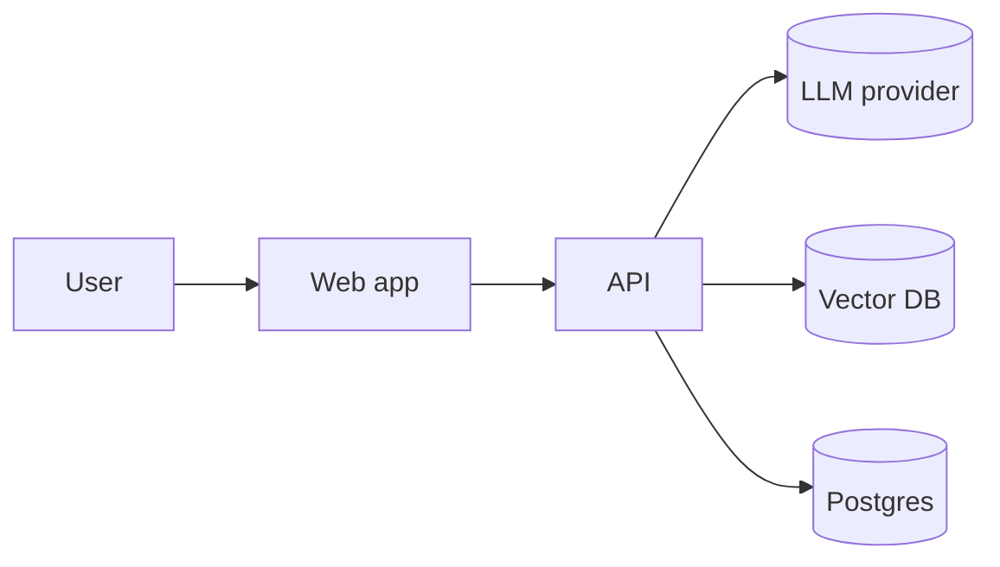

# PLAN.md — <project name>

_Last updated by LEAD: <time> · LEAD_BRANCH: <branch> · Deadline: <from TASK.md>_

## 1. Problem and users
- One sentence: <who> needs <what> because <why>.
- Primary user(s) and their context.
- What success looks like for the judges (map to the rubric).

## 2. Golden path (the demo story — everything serves this)
1. <user does X> → <system shows Y>
2. ...
(5–7 steps. Each step names the screen/endpoint involved.)

## 3. Requirements
### Functional
- FR-1 ...
### Non-functional
- NFR-1 Latency: first token < 2 s; page interactive < 2 s
- NFR-2 Cost: < $<x> per request; token caps per request
- NFR-3 Privacy/security: <PII handling, auth needs>
- NFR-4 Scale for demo: <docs, users, requests/min>

### Feature priorities (scored against judging criteria)
| Feature | Priority | Rubric criteria it scores | Acceptance criteria (Given/When/Then) |
|---|---|---|---|
| ... | MUST | ... | Given ..., when ..., then ... |
| ... | SHOULD | ... | ... |
| ... | WOW | ... | ... |

## 4. Architecture
- Archetype(s): <from architecture-blueprint>
- Stack: <backend, frontend, data, vector store, LLM provider(s), deploy target>

## 5. Contracts
- Source of truth: Pydantic schemas in `apps/api/app/schemas/` → exported `contracts/openapi.json`.
| Method | Path | Purpose | Request | Response | Streaming |
|---|---|---|---|---|---|

## 6. Data model
| Entity | Key fields | Indexes | Notes |
|---|---|---|---|
Vector collections: name, embedding model, dimension, distance, payload fields + indexes.

## 7. Ports and ownership
| Role / worker | Dev port(s) | Owns (may edit) |
|---|---|---|
| LEAD | api 8000 | `contracts/`, `apps/api/app/schemas/`, `compose.yaml`, root `package.json`, `.env.example`, `docs/adr/`, `docs/architecture.md` |
| core-* | api 8001/8002 | `apps/api/app/**` except `schemas/` and `adapters/db/`, `apps/api/tests/unit/**` |
| ui-* | web 3001 (+ api 8003) | `apps/web/**` except `apps/web/e2e/**` |
| data-* | — | `apps/api/migrations/**`, `apps/api/app/adapters/db/**`, `apps/api/scripts/seed*.py`, `data/**` |
| qa-* | — | `apps/api/tests/integration/**`, `apps/api/evals/**`, `apps/web/e2e/**`, `scripts/**`, `.github/**`, `README.md`, `docs/demo.md` |
Shared infra (started once by LEAD): Postgres 5432 · Qdrant 6333 · Redis 6379.

## 8. Waves and tasks
| Task | Wave | Role | Agent/model | Title | Deps | Needs creds | RACE |
|---|---|---|---|---|---|---|---|

## 9. Risks and mitigations
| Risk | Likelihood | Impact | Mitigation |
|---|---|---|---|
| LLM provider outage during demo | M | H | DEMO_REPLAY recorded responses |
