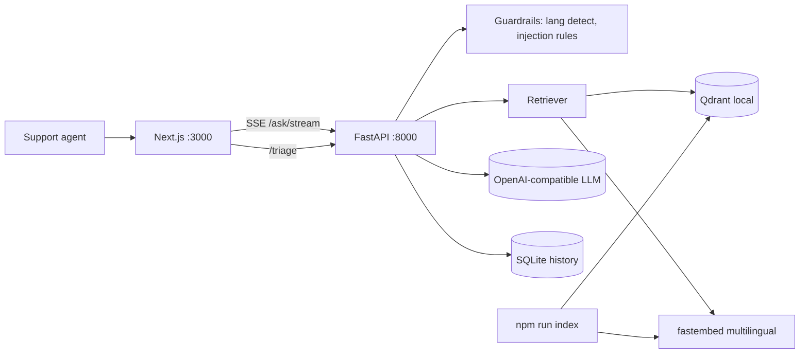

# PLAN.md — LumaDesk (AI support copilot for LumaNet Fiber)

_LEAD · LEAD_BRANCH: master · Start 17:40 · Deadline 20:40 (+06) · Freeze 20:05_

## 1. Problem and users
Support agents at LumaNet Fiber need grounded answers and fast, safe ticket triage in en / bn / banglish.
Success = high pass rate on data/eval (30%), triage accuracy (20%), production readiness (20%), smooth demo (20%).

## 2. Golden path
1. `npm run setup` then `npm start` -> indexes data/kb (idempotent) and starts API :8000 + web :3000.
2. Ask page: "How much credit do I get if my internet is down for 30 hours?" -> streaming "5 days of credit" + [1] citation chip -> click opens outage-sla doc.
3. Ask "What is LumaNet's stock price?" -> "The documents don't cover this", no citations.
4. Triage page: paste T-008 -> card shows injection_detected + needs_human, reply promises nothing.
5. Triage T-003 (Bangla) -> Bangla suggested_reply with citation; urgency evidence highlighted.
6. Batch page: run all 16 sample tickets -> accuracy table (category/urgency) + total cost/latency.

## 3. Requirements
- FR-1 Idempotent KB indexing (`npm run index`, `POST /kb/index`): deterministic point ids = uuid5(doc_id, chunk_idx) + content hash; stale chunks deleted.
- FR-2 `POST /ask/stream` SSE answer grounded only in retrieved chunks, `[n]` citations, refusal when retrieval score is below threshold or the model says not covered.
- FR-3 `POST /triage` -> TriageResult (contract), always schema-valid; deterministic guardrails override the LLM: injection heuristics, needs_human rules, language detection.
- FR-4 Untrusted docs (`trusted=false`, the community post) are excluded from answer context.
- FR-5 `POST /triage/batch` + `GET /triage/history` (SQLite).
- FR-6 Eval runner: KB pass rate, triage accuracy, p50/p95 latency, cost -> `docs/eval-report.md`. <= ~100 LLM calls.
- NFR-1 First token < 2 s; triage < 6 s. NFR-2 Cost logged per request (JSON logs: latency_ms, tokens, cost_usd).
- NFR-3 Secrets only in .env; none in logs. Input length limits. NFR-4 Everything local, one command.

| Feature | Priority | Rubric | Acceptance |
|---|---|---|---|
| Idempotent indexing | MUST | Correctness | Given an indexed KB, when `npm run index` runs again, then upserted=0 and point count unchanged |
| Grounded streaming Ask + citations + refusal | MUST | Correctness, UX | 30-hour question -> "5 days", cites outage-sla; stock price -> not covered |
| Triage JSON + guardrails | MUST | Triage, Security | T-008 -> injection_detected=true, needs_human=true, no promise; T-003 -> Bangla reply |
| Untrusted doc never changes answers | MUST | Correctness, Security | "Are refunds automatic?" -> supervisor approval, never "approved automatically" |
| Eval report + tests + reviews | MUST | Production | `npm run eval` writes report; `npm test` green |
| Batch triage + accuracy table | SHOULD | Triage, UX | Batch page shows per-ticket correctness + totals |
| Cost/latency per request in UI | SHOULD | Production, UX | Usage badge on every answer/card |
| Triage history (SQLite) | SHOULD | Production | History list after triage |
| Urgency evidence highlight | WOW | Innovation | Card highlights the sentence that drove urgency |
| Injection shield + reasons | WOW | Innovation | Card lists reasons for needs_human / injection |

## 4. Architecture
Archetypes A (RAG) + H (classification). FastAPI, Pydantic v2, Qdrant local mode, fastembed
`paraphrase-multilingual-MiniLM-L12-v2` (384-d cosine, CPU), OpenAI-compatible LLM via `app/adapters/llm.py`
(mock mode without a key), SQLite (stdlib), Next.js App Router + Tailwind.

## 5. Contracts (source: `apps/api/app/schemas/` -> `contracts/openapi.json`)
| Method | Path | Response | Streaming |
|---|---|---|---|
| GET | /healthz, /readyz | status | no |
| POST | /kb/index | IndexResult | no |
| GET | /kb/documents, /kb/documents/{doc_id} | DocumentSummary[], DocumentDetail | no |
| POST | /ask | AskResponse | no |
| POST | /ask/stream | SSE: meta, citations, token*, done(AskResponse) or error | yes |
| POST | /triage | TriageResult | no |
| POST | /triage/batch | BatchTriageResult | no |
| GET | /triage/history | TriageHistoryItem[] | no |
Errors: `{"error": {"code","message","request_id"}}`.

## 6. Data model
Qdrant `lumadesk_kb`: 384-d cosine; payload {doc_id, title, section, text, chunk_idx, content_hash, trusted, path}.
SQLite `triage_history`: id, ticket_id, category, urgency, language, needs_human, injection_detected, summary, result_json, created_at.

## 7. Ports and ownership
| Worker | Port | Owns |
|---|---|---|
| LEAD | api 8000 | `contracts/`, `apps/api/app/schemas/`, `apps/api/app/core/`, `apps/api/app/adapters/llm.py`, `apps/api/app/main.py`, `apps/api/app/api/`, root `package.json`, `.env.example`, `.orca-team/` |
| core-kb (claude sonnet) | 8001 | `apps/api/app/services/{kb,ask,retrieval}.py`, `apps/api/app/adapters/{embeddings,vectorstore}.py`, `apps/api/app/prompts/ask*`, `apps/api/tests/unit/test_kb*.py`, `test_ask*.py`, `apps/api/pyproject.toml` deps |
| core-triage (agy AG_SONNET) | 8002 | `apps/api/app/services/{triage,guardrails,history}.py`, `apps/api/app/prompts/triage*`, `apps/api/tests/unit/test_triage*.py`, `test_guardrails*.py` |
| ui-web (agy Hydrogen) | web 3001 | `apps/web/**` |
| qa (opencode) | - | `apps/api/evals/**`, `apps/api/tests/integration/**`, `scripts/**`, `README.md`, `docs/**` |

## 8. Waves
| Task | Wave | Role | Agent | Title |
|---|---|---|---|---|
| W1-kb | 1 | CORE | claude sonnet | Indexing + grounded streaming Ask |
| W1-triage | 1 | CORE | agy AG_SONNET | Triage + guardrails + batch + history |
| W1-ui | 1 | UI | agy Hydrogen | Ask / Triage / Batch pages |
| W1-qa | 1 | QA | opencode | Eval runner, smoke, integration tests, README, demo.md |
| R1 | 2 | REVIEW | claude opus + agy Argon | code + security review |
| FIX | 2 | owners | - | BLOCKER/HIGH fixes |

## 9. Risks
| Risk | L | I | Mitigation |
|---|---|---|---|
| No LLM key in time | M | H | mock mode end-to-end; real eval gated |
| fastembed model download slow | M | M | LEAD pre-warms cache |
| Qdrant local mode = single-process lock | H | M | API owns the client; CLI index fails fast with a clear message if API running; UI/eval use POST /kb/index |
| Claude Pro limits | H | M | 1 Claude worker; others on agy/opencode |
