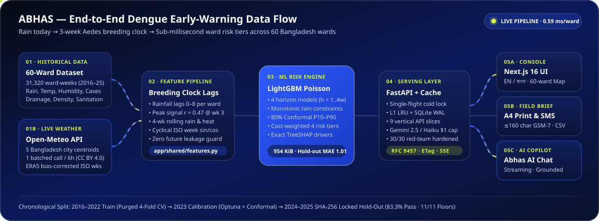

# Abhas (আভাস) — Architecture Overview

Abhas is a production-grade dengue early-warning operations console built for Bangladesh municipal health officers. It translates multi-week monsoon rainfall surges into actionable, ward-level outbreak risk forecasts 1–4 weeks in advance across 60 wards in **Dhaka North (DNCC)**, **Dhaka South (DSCC)**, **Chattogram (CCC)**, **Gazipur (GCC)**, and **Narayanganj (NCC)**.

---

## 1. System Data Flow

```mermaid
flowchart LR
    subgraph Ingestion ["1. Data Ingestion"]
        XLSX["Historical Dataset<br/>(2016–2025, 60 Wards)"]
        METEO["Open-Meteo API<br/>(5 City Centroids · 6h Cache)"]
    end

    subgraph FeaturePipeline ["2. Deterministic Feature Pipeline"]
        FEAT["app/shared/features.py<br/>• Rainfall Lags 0–8 (Peak r=0.47 @ Wk 3)<br/>• 4-Wk Rolling Rain / Temp / Humidity<br/>• Risk Indices & Cyclical ISO Week"]
    end

    subgraph RiskEngine ["3. Multi-Horizon Risk Engine"]
        LGBM["LightGBM Poisson Regressor<br/>(current.joblib · 954 KiB)<br/>• Horizons h=1..4<br/>• Monotonic Rainfall Constraints"]
        CALIB["Conformal 80% Intervals<br/>(NegBin Calibration on 2023)"]
        TIERS["Tiers & Endemic Channel<br/>(Low / Medium / High / Critical)"]
        SHAP["Explainability Engine<br/>(TreeSHAP Feature Drivers)"]
    end

    subgraph Serving ["4. Production API (FastAPI)"]
        API["FastAPI Modular Monolith (9 Slices)<br/>• Single-Flight Cold Lock<br/>• L1 LRU + SQLite WAL Cache<br/>• Sub-millisecond CPU Serving"]
    end

    subgraph Console ["5. Operations Console (Next.js 16)"]
        UI["Next.js 16 Console (11 Slices)<br/>• Full Bilingual EN / বাংলা UI<br/>• Live Open-Meteo Toggle · A4 · CSV<br/>• Grounded Abhas AI Assistant"]
    end

    XLSX --> FEAT
    METEO --> FEAT
    FEAT --> LGBM
    LGBM --> CALIB
    CALIB --> TIERS
    TIERS --> SHAP
    SHAP --> API
    API --> UI
```

<p align="center">
  
</p>



---

## 2. Chronological Split Timeline

To eliminate temporal data leakage in time-series forecasting, the 10-year dataset is partitioned strictly by calendar year boundaries:

```text
[2016 — 2022: Training & Validation] ──► [2023: Calibration & Tuning] ──► [2024 — 2025: Locked Hold-Out]
 • Purged expanding-window CV (4 folds)    • Optuna Hyperparameter Search           • Strictly locked by SHA-256
 • Grouped ward_id lag engineering         • Conformal 80% coverage tuning (84.5%)  • Zero tuning or thresholding
 • Monotonic constraint specification      • Cost-weighted risk tiers (5x penalty)  • Scored ONCE at evaluation
 • Seasonal baseline benchmarking          • Endemic channel thresholding (Mean+2SD)• 11/11 AC-5 floors PASS (83.3%)
```

- **Training Folds (2016–2022):** 4 expanding-window folds with 8-week purging margins between train and test windows to prevent lag contamination.
- **Tuning & Calibration (2023):** Reserved exclusively for Optuna hyperparameter search, Negative Binomial dispersion estimation, conformal 80% interval calibration, and asymmetric cost tier cut-offs (penalizing a missed outbreak 5× more heavily than a false alarm).
- **Locked Hold-Out (2024–2025):** Locked by SHA-256 hash (`4ab5539f...714b`) and scored once — achieving an **83.33% golden pass rate** across 48 target slices, **11/11 quality floors**, and **-19.8% lower 3-week MAE** (1.01 vs 1.26 seasonal baseline).

---

## 3. Model Selection Rationale & Rejected Alternatives

| Candidate | Status | Outcome / Rationale |
|---|---|---|
| **LightGBM Poisson (Multi-Horizon)** | **Selected** | **Production choice.** Natural count-data likelihood with overdispersion; strict monotonic constraints enforce that higher rainfall never lowers predicted risk; 954 KiB artifact size; sub-millisecond CPU inference (`p95 = 0.591 ms/ward`). |
| **XGBoost CUDA Challenger** | Rejected | Tested on NVIDIA RTX 3060 CUDA: mean CV MAE `1.2050` vs LightGBM `1.2033` (`-0.14%` delta) — below the +3.0% threshold needed to justify heavier runtime dependencies. |
| **Negative Binomial / Poisson GLM** | Rejected | Log-linear link functions miss the non-linear inflection at lag 3 (the 21-day mosquito maturation and incubation cascade). |
| **Deep Learning (LSTM / TFT / Chronos)** | Rejected | Overfits on ~30k ward-week rows; requires >2 GB GPU runtime dependencies; non-deterministic training; slow cold-start latency. |
| **ARIMA / Prophet** | Rejected | Cannot share cross-ward vulnerability features or weather lag matrices; requires maintaining 240 separate models (60 wards × 4 horizons). |
| **RAG / Vector Databases** | Rejected | Epidemiological risk scoring requires deterministic tabular math and exact TreeSHAP attribution rather than stochastic text retrieval. |
| **SQLite WAL → PostgreSQL Port** | Architecture Port | SQLite WAL delivers zero-credential Stage 1 setup in < 30 seconds; SQLAlchemy 2.0 + Alembic ports allow zero-rewrite Stage 2 promotion to PostgreSQL/Neon. |

---

## 4. Hardware Optimization: GPU Training & CPU Serving

- **GPU Training (NVIDIA RTX 3060 12 GB):** Optuna tuning completed in **37.71 s** (139 MiB VRAM, 54.87 W peak). Standalone verifier (`ml/verify_artifact.py`) proves CPU inference matches within `±0.0000` MAE.
- **CPU Serving (Zero GPU Required):** `apps/api/ml/artifacts/current.joblib` (977,463 bytes) is loaded **once** into FastAPI lifespan state; single-ward inference executes in **0.591 ms (p95)**, and full 60-ward × 4-horizon citywide scoring completes in **< 35 ms** on a standard office laptop CPU.

---

## 5. Compute, API & LLM Cost Controls

```text
┌────────────────────────────────────────────────────────────────────────┐
│                        MONTHLY OPERATIONAL COST                        │
│                                                                        │
│  • Compute (FastAPI + Next.js on office laptop / $5 VPS):        $0.00 │
│  • LightGBM CPU Inference (954 KiB artifact, loaded once):       $0.00 │
│  • Open-Meteo Weather API (1 batched 5-city call / 6h, 4/day):   $0.00 │
│  • Storage (Local SQLite WAL / PostgreSQL free tier):            $0.00 │
│  • Optional LLMs (Gemini 2.5 Flash chat + Haiku advisory, cap):  $0–$1 │
│                                                                        │
│  TOTAL ESTIMATED RUNNING COST:                       $0.00 — $5.00/mo  │
└────────────────────────────────────────────────────────────────────────┘
```

1. **Single-Flight Cold Lock & Two-Tier Cache:** Concurrent requests for the same `(origin_week, source, weather_hash)` coalesce on a per-key lock. Hot forecasts serve in `< 2 ms` from L1 LRU or L2 SQLite `predictions_cache`. What-if counterfactual scenarios bypass persistent cache writes.
2. **Open-Meteo Call Minimization:** All 5 Bangladesh city centroids are fetched in **1 multi-location HTTP GET** (`past_days=92&forecast_days=16`, `Asia/Dhaka`), aggregated to full Mon–Sun ISO weeks, ERA5 bias-corrected, and cached in SQLite `weather_cache` for **6 hours** (**≤ 4 calls/day** out of Open-Meteo's 10,000/day free tier), with retries, circuit breaker, and climatology fallback.
3. **LLM Token, Budget & Redaction Controls:**
   - **Officer Briefings (`advisory`):** Optional Anthropic Claude Haiku capped at 400 output tokens, post-validated against forecast numbers, and hard-capped at **$1.00/day** via SQLite `llm_traces`; falls back to free deterministic bilingual templates.
   - **Abhas AI Assistant (`chat`):** Optional Google Gemini 2.5 Flash (`thinkingBudget: 0`, max 512 tokens, dual-key `429` failover, response TTL cache, `llm_traces` ledger, `AQ.*`/key log redaction, per-IP rate limiting) with automatic grounded offline fallback when keys are absent.

---

## 6. Deep-Dive Architecture Specifications

- [Animated System Design Diagram](docs/diagrams/system-design.svg) · [Animated Entity Relationship Diagram](docs/diagrams/erd.svg)
- [C4 Architecture Diagrams & Module Boundaries](docs/architecture.md)
- [ADR Index (ADR-0001 through ADR-0008)](docs/adr/0001-modular-monolith-slices.md)
- [System Design & Latency Budgets](docs/system-design.md)
- [AI Model Design & Model Card](docs/model-card.md) · [Threat Model](docs/threat-model.md)
