# Abhas (আভাস) — Architecture Overview

Abhas is a production-grade dengue early-warning operations console built for Bangladesh municipal health officers. It translates multi-week monsoon rainfall surges into actionable, ward-level outbreak risk forecasts 1–4 weeks in advance across 60 city corporation wards.

---

## 1. System Data Flow

```mermaid
flowchart LR
    subgraph Ingestion ["1. Data Ingestion"]
        XLSX["Historical Dataset<br/>(2016–2025, 60 Wards)"]
        METEO["Open-Meteo API<br/>(Centroids / 6h Cache)"]
    end

    subgraph FeaturePipeline ["2. Deterministic Feature Pipeline"]
        FEAT["app/shared/features.py<br/>• Rainfall Lags 0–8 (Peak @ Wk 3)<br/>• 4-Wk Rolling Rain / Temp / Humidity<br/>• Risk Indices & Cyclical ISO Week"]
    end

    subgraph RiskEngine ["3. Multi-Horizon Risk Engine"]
        LGBM["LightGBM Poisson Regressor<br/>(current.joblib · 954 KiB)<br/>• Horizons h=1..4<br/>• Monotonic Rainfall Constraints"]
        CALIB["Conformal 80% Intervals<br/>(NegBin Calibration on 2023)"]
        TIERS["Tiers & Endemic Channel<br/>(Low / Medium / High / Critical)"]
        SHAP["Explainability Engine<br/>(TreeSHAP Feature Drivers)"]
    end

    subgraph Serving ["4. Production API (FastAPI)"]
        API["FastAPI Modular Monolith<br/>• Single-Flight Cold Lock<br/>• L1 LRU + SQLite Cache<br/>• Sub-millisecond CPU Serving"]
    end

    subgraph Console ["5. Operations Console (Next.js)"]
        UI["Next.js 16 Console<br/>• Bilingual EN / বাংলা Interface<br/>• WCAG 2.2 AA Accessible<br/>• Priority List & Safe CSV Export"]
    end

    XLSX --> FEAT
    METEO --> FEAT
    FEAT --> LGBM
    LGBM --> CALIB
    CALIB --> TIERS
    TIERS --> SHAP
    SHAP --> API
    API --> UI
```



---

## 2. Chronological Split Timeline

To prevent data leakage in time-series forecasting, the dataset is split strictly by chronological year boundaries:

```
[2016 — 2022: Training & Validation] ──► [2023: Calibration & Tuning] ──► [2024 — 2025: Locked Hold-Out]
 • Purged expanding-window CV (4 folds)    • Optuna Hyperparameter Search           • Strictly locked by SHA-256
 • Spatial feature engineering             • Conformal 80% coverage tuning (84.5%)  • Zero tuning or thresholding
 • Monotonic constraint specification      • Cost-weighted risk tiers (5x penalty)  • Scored ONCE at evaluation
 • Baseline benchmarking                   • Endemic channel thresholding (Mean+2SD)• 11/11 AC-5 floors PASS (83.3%)
```

- **Training Folds (2016–2022):** 4 expanding-window folds with 8-week purging margins between train and test windows to prevent lag contamination.
- **Tuning & Calibration (2023):** Reserved exclusively for Optuna hyperparameter optimization, Negative Binomial dispersion parameter $r$ estimation, conformal 80% interval calibration, and asymmetric cost tier cut-offs (4.5, 9.0, 11.0 expected cases; penalizing a missed outbreak 5× more than a false alarm).
- **Locked Hold-Out (2024–2025):** Locked by SHA-256 hash (`4ab5539f...714b`). The model is evaluated on this split exactly once. It achieved an 83.33% golden pass rate across 48 target slices with 11/11 acceptance criteria floors met.

---

## 3. Model Selection Rationale & Rejected Alternatives

| Candidate | Status | Outcome / Rationale |
|---|---|---|
| **LightGBM Poisson (Multi-Horizon)** | **Selected** | **Production choice.** Natural handling of count data with overdispersion; strict monotonic constraints enforce that increased rainfall never decreases predicted risk; 954 KiB artifact size; sub-millisecond CPU inference (p95 = 0.591 ms/ward). |
| **XGBoost CUDA Challenger** | Rejected | Tested on NVIDIA RTX 3060 CUDA: achieved mean CV MAE of 1.2050 vs LightGBM 1.2033 (-0.14% delta). Did not meet the +3.0% threshold required to justify larger runtime dependencies. |
| **Negative Binomial / Poisson GLM** | Rejected | Log-linear link functions fail to capture the non-linear inflection at lag 3 (the 21-day incubation and larval development cascade). |
| **Deep Learning (LSTM / TFT / Chronos)** | Rejected | Severe overfitting on 60 wards $\times$ 10 years weekly data (~30,000 rows); required GPU runtime dependencies (>2 GB); non-deterministic training runs; unacceptable cold-start latency. |
| **ARIMA / Prophet** | Rejected | Cannot share cross-ward spatial risk features or weather lag matrices; intractable to maintain and serve 240 separate models (60 wards $\times$ 4 horizons). |
| **RAG / Vector Databases** | Rejected | Epidemiological early warning relies on deterministic tabular math and verified physical features; generative vector retrieval introduces hallucinations and unverifiable risk scores. |
| **Postgres / Neon (Stage 1)** | Architecture Port | SQLite with WAL mode was selected for Stage 1 to provide zero network overhead, zero external credentials, and an instant fresh clone in < 30 seconds. Clean ports and adapters allow seamless promotion to PostgreSQL in Stage 2. |

---

## 4. Hardware Optimization: GPU Training & CPU Serving

Abhas enforces a clear separation between compute-intensive training and ultra-lightweight edge serving:

### GPU Training (NVIDIA GeForce RTX 3060 12 GB)
- **Tuning Loop:** Optuna Bayesian hyperparameter search executed in 37.71 seconds.
- **Hardware Telemetry:** Peak GPU utilization 50.0% (mean 19.57%), 139.0 MiB VRAM allocated, peak power 54.87 W at 55.0°C.
- **Artifact Verification:** Standalone validator (`ml/verify_artifact.py`) confirms model reproducibility on CPU within $\pm 0.0000$ MAE difference.

### CPU Serving (Zero GPU Required in Production)
- **Model Loading:** The artifact (`current.joblib`, 977,463 bytes) is deserialized exactly once at FastAPI startup into application lifespan state.
- **Latency Budget:** Single-ward inference executes in 0.591 ms (p95), well below the 300 ms SLA.
- **Batch Processing:** Full 60-ward citywide forecast for all 4 horizons completes in under 35 ms on a single standard CPU core.

---

## 5. Cost Controls & Operational Economics

Abhas is designed for municipal health departments in developing economies where IT budgets are constrained:

```
┌────────────────────────────────────────────────────────────────────────┐
│                        MONTHLY OPERATIONAL COST                        │
│                                                                        │
│  • Compute (FastAPI + Next.js on existing municipal PC / $5 VPS): $0.00│
│  • Primary Inference Engine (LightGBM on CPU):                    $0.00│
│  • Weather Forecast API (Open-Meteo CC BY 4.0 centroid cache):   $0.00│
│  • Database (Local SQLite WAL / Neon Free Tier in Stage 2):       $0.00│
│  • Optional LLM Advisory (Anthropic Claude Haiku, $1/day hard cap): $0 │
│                                                                        │
│  TOTAL ESTIMATED RUNNING COST:                     $0.00 — $5.00 / mo  │
└────────────────────────────────────────────────────────────────────────┘
```

1. **Single-Flight Cold Lock:** Cold requests for an uncomputed `(origin_week, source, weather_hash)` acquire a per-key lock; concurrent queries await the primary computation, eliminating redundant CPU spikes.
2. **Two-Tier Cache Architecture:** In-memory LRU cache serves hot requests in < 2 ms; SQLite-backed `predictions_cache` persists across restarts. What-if counterfactual scenarios never pollute the persistent cache.
3. **Open-Meteo Rate Protection:** Five city centroid forecasts are batched into a single HTTP request every 6 hours (4 calls/day out of a 10,000/day free limit).
4. **Advisory Hard Budget:** When an optional `ANTHROPIC_API_KEY` is provided, prompt tokens are capped at 400, output numbers must strictly match the forecast input data, and daily spend is capped at $1.00 via persistent SQLite ledger (`llm_traces`). In zero-key mode, a deterministic template generates bilingual advisories for free.

---

## 6. Architecture Links & Specifications

For comprehensive C4 component specifications, sequence diagrams, and Architecture Decision Records:
- [C4 Architecture Diagrams & Module Boundaries](file:///e:/AI%20Engineering%20Hackathon/docs/architecture.md)
- [ADR Index (ADR-0001 through ADR-0008)](file:///e:/AI%20Engineering%20Hackathon/docs/adr/0001-modular-monolith-slices.md)
- [System Design & Latency Budgets](file:///e:/AI%20Engineering%20Hackathon/docs/system-design.md)
- [AI Model Design & Validation Proofs](file:///e:/AI%20Engineering%20Hackathon/docs/ai-design.md)
