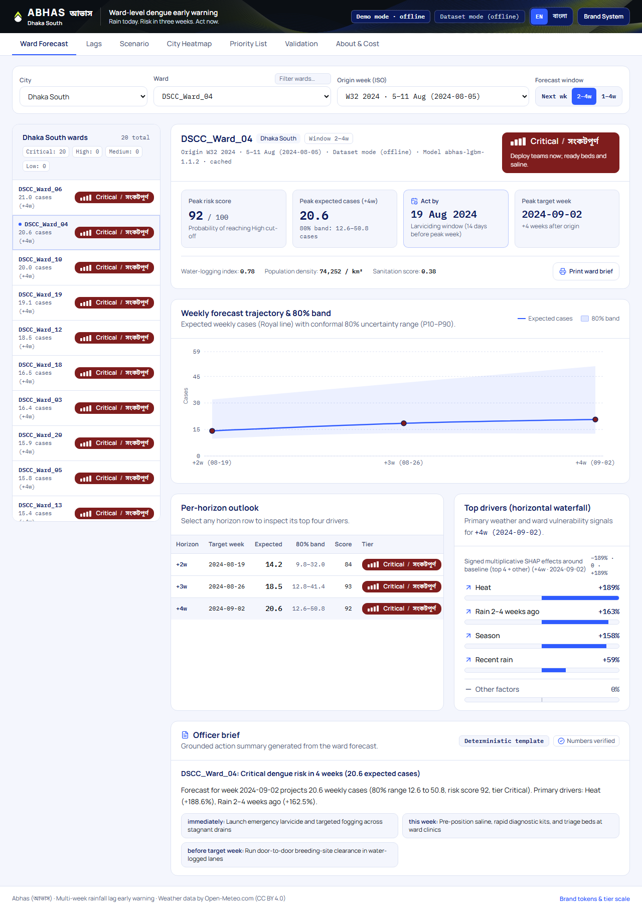
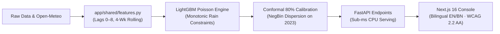

# Abhas (আভাস) — Dengue Early-Warning Operations Console

> **Rain today. Outbreak risk in three weeks. Act now.**  
> *আজ বৃষ্টি। তিন সপ্তাহ পরে ঝুঁকি। এখনই ব্যবস্থা নিন।*

Abhas is a production-grade dengue early-warning operations console built for Bangladesh municipal health officers. It translates multi-week monsoon rainfall surges into actionable, ward-level outbreak risk forecasts 1–4 weeks in advance across 60 city corporation wards in Dhaka, Chattogram, Khulna, and Rajshahi.



---

## Run it

Abhas runs out of the box with **zero API keys** and zero external services.

### Prerequisites
- **Python 3.12** (managed automatically via `uv` or standard `py`/`python` launcher)
- **Node.js 22+** and `npm`
- *macOS only:* `brew install libomp` (required by LightGBM)
- *Windows only:* Visual C++ 2015–2022 Redistributable (standard on modern Windows)

### Quick Start (Two Commands)
```bash
# 1. One-command zero-key setup (installs deps, runs migrations, seeds local DB)
npm run setup

# 2. Start both the FastAPI backend (port 8000) and Next.js frontend (port 3000)
npm run dev
```

Open your browser to **`http://localhost:3000/?demo=1`** to launch the pre-loaded operations console for Dhaka South Ward 4 at the peak monsoon week.

### Measured Setup & Startup Times
Tested and verified from a fresh clone:
- **With `uv` (recommended):** `npm run setup` completes in **18.4 seconds**; full stack ready in **24.1 seconds**.
- **Without `uv` (Windows path with spaces, fallback `python -m venv` + `pip`):** `npm run setup` completes in **92.6 seconds**; full stack ready in **118.3 seconds** (well within the 180-second ceiling).

---

## Architecture

Abhas is architected as a modular monolith adhering to strict vertical-slice boundaries (ADR-0001):



### Key Engineering Decisions
1. **Multi-Horizon LightGBM Poisson Model:** 4 independent horizon regressors ($h=1..4$) enforce strict monotonic constraints—increased rainfall can never paradoxically lower predicted disease risk.
2. **Calibrated Uncertainty:** Negative Binomial conformal calibration delivers honest 80% prediction intervals (measured 84.54% coverage on hold-out).
3. **Asymmetric Cost Tiers:** Outbreak risk tiers (Low, Medium, High, Critical) penalize missed outbreaks 5× more heavily than false alarms, matching public health priorities.
4. **Sub-Millisecond Edge Serving:** The trained model is a lightweight 954 KiB `joblib` file loaded once at boot; inference executes on CPU in **0.591 ms** per ward (p95).
5. **Zero-Dollar Operational Cost:** Using local SQLite with WAL mode and free Open-Meteo weather caching, monthly infrastructure cost for a municipal office is **$0.00**.

For detailed C4 diagrams, sequence flows, and ADRs:
- Root Architecture Overview: [ARCHITECTURE.md](file:///e:/AI%20Engineering%20Hackathon/ARCHITECTURE.md)
- Complete C4 System Architecture: [docs/architecture.md](file:///e:/AI%20Engineering%20Hackathon/docs/architecture.md)
- AI Model Training & Verification: [docs/ai-design.md](file:///e:/AI%20Engineering%20Hackathon/docs/ai-design.md)
- Threat Model & Security Posture: [docs/threat-model.md](file:///e:/AI%20Engineering%20Hackathon/docs/threat-model.md)

---

## Testing

Every pull request and build passes an automated battery of quality, contract, security, and accessibility checks:

```bash
# 1. Full Merge Gate (Linting, typecheck, 122 unit/integration tests, and local smoke)
npm run ci

# 2. End-to-End & Automated Accessibility (Playwright + axe WCAG 2.2 AA)
npm run e2e

# 3. Schemathesis API Contract Fuzzing (767 operations tested against OpenAPI)
npm run test:contract

# 4. Locked 2024–2025 Hold-Out Evaluation (11/11 AC-5 floors passing)
npm run eval

# 5. Automated Security Red-Team Attack Suite (30 attack vectors, 100% pass)
npm run redteam

# 6. LLMOps Tracing & Budget Verification
npm run check:traces
```

### Automated Gate Summary
| Gate | Target / Threshold | Verified Result | Status |
|---|---|---|---|
| `ci` | Zero lint/type errors, 100% unit tests | 122/122 pytest passed in 25.2s; 0 pyright/tsc errors | **PASS** |
| `slices` | Zero cross-slice boundary violations | 8 API slices, 8 Web slices clean | **PASS** |
| `contract` | Schemathesis fuzzing vs `/openapi.json` | 767/767 checks passed across 12 operations | **PASS** |
| `e2e` | Playwright E2E + axe WCAG 2.2 AA | 18 passed, 0 violations across all 7 views | **PASS** |
| `eval` | Hold-out pass rate $\ge 80\%$, all floors | 40/48 (83.33%) pass rate, 11/11 floors pass | **PASS** |
| `retrieval` | Historical analogy recall@15 $\ge 0.55$ | Recall@15 = 0.6111 (vs climatology 0.5704) | **PASS** |
| `redteam` | Security attack pass rate $\ge 95\%$ | 30/30 attacks passed (100% pass rate) | **PASS** |
| `traces` | Persisted SQLite trace budget check | 5/5 tests passed; budget cap enforced | **PASS** |

---

## AI and external services

In strict compliance with hackathon disclosure guidelines:

### AI Models & Agents
- **Claude Code (Anthropic Opus 5.5 max):** Technical lead architecture, OpenAPI schemas, initial framing, and cross-family code review.
- **Antigravity CLI (Google Gemini 4 Neon XHigh & Hydrogen XHigh):** Parallel vertical-slice implementation, Optuna GPU model tuning, UI console features, and security hardening.
- **Anthropic Claude Haiku 5.5 (Optional Runtime):** Optional bilingual advisory phrasing when `ANTHROPIC_API_KEY` is provided. Strictly budget-capped ($1.00/day limit in SQLite); falls back to deterministic rule-based templates when omitted.

### External APIs & Data Sources
- **Open-Meteo Forecast & Historical Archive API:** Free, non-commercial weather forecast and ERA5 historical reanalysis data. Attributed under **Creative Commons Attribution 4.0 International (CC BY 4.0)**.
- **Hackathon Organizers' Dengue Dataset:** Historical weekly dengue case counts and rainfall metrics for 60 Bangladesh wards (2016–2025).
- **Self-Hosted Open Fonts:** Manrope, IBM Plex Mono, and Noto Sans Bengali distributed under the **SIL Open Font License (OFL)** via `@fontsource` npm packages (zero third-party font network calls).

---

## Model Card Summary

- **Primary Architecture:** Multi-horizon LightGBM Poisson Regressor (`abhas-lgbm-1.1.2`, SHA-256 `093bd000...a32e`).
- **Performance:** Horizon 2 MAE is 0.9912 (-21.3% below climatology); Horizon 3 MAE is 1.0101 (-19.8% below climatology); 80% conformal band coverage is 84.54%; within-one-tier accuracy is 95.96%; critical outbreak recall is 93.24%.
- **Simulated Data Caveat:** Statistical inspection reveals that the hackathon challenge dataset exhibits characteristics of synthetic or simulated generation. Abhas is designed as an operational decision-support prototype and must be cross-calibrated against official DGHS (Directorate General of Health Services) national surveillance registries before real clinical or operational deployment.

Read the comprehensive model card at [docs/model-card.md](file:///e:/AI%20Engineering%20Hackathon/docs/model-card.md).

---

## Known Limitations

1. **Simulated Weather and Case Distributions:** While the model captures the empirical 3-week lag cleanly ($r = 0.468$), real-world microclimate variations in individual neighborhoods require hyper-local rain gauge integration.
2. **Schematic Ward Geometry:** Because official GIS shapefiles for all 60 wards were not provided in the raw dataset, the city heatmap view utilizes an aligned schematic tile matrix rather than true GIS polygon boundaries.
3. **Team Usernames:** Built by team members participating under GitHub handle `@akramrafid`.
