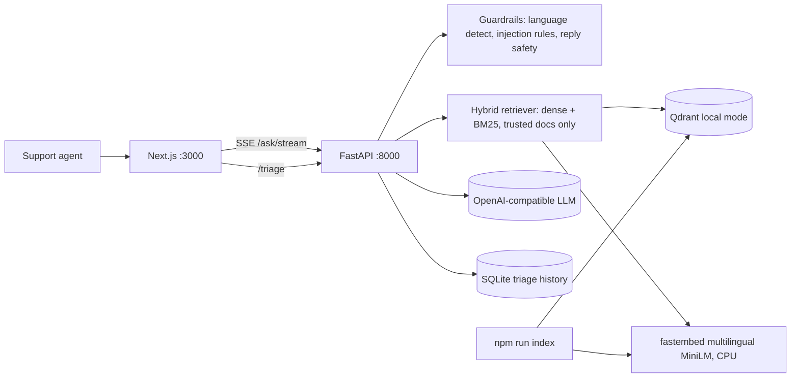

# LumaDesk — AI copilot for LumaNet Fiber support agents

LumaDesk helps support agents at **LumaNet Fiber** (a fictional ISP; all data in `data/` is synthetic) in
English, Bangla and Banglish:

1. **Ask the knowledge base**: a streaming chat answer grounded only in `data/kb`, with clickable `[n]` citations.
   If the documents don't cover the question, it says so instead of guessing.
2. **Triage a ticket**: a schema-valid triage card (category, urgency, sentiment, language, summary,
   `needs_human`, `injection_detected`, `suggested_reply` in the customer's language citing the KB).
3. **Batch triage**: all 16 labelled sample tickets with an accuracy table against the labels.

## Architecture



- **API**: FastAPI + Pydantic v2 (`apps/api`). The Pydantic schemas are the contract, exported to
  `contracts/openapi.json`. JSON logs carry a request id, latency, tokens and cost for every LLM call.
- **Retrieval**: markdown chunked by heading, embedded locally with
  `paraphrase-multilingual-MiniLM-L12-v2` (384-d), stored in Qdrant local mode. Indexing is idempotent:
  point ids are `uuid5(doc, chunk)`, unchanged chunks are skipped and stale ones deleted.
- **LLM**: any OpenAI-compatible endpoint via `app/adapters/llm.py`, with a primary and fallback model, cooldown
  after 429/5xx, JSON-repair retry, and mock mode when no key is set.
- **Web**: Next.js App Router + Tailwind (`apps/web`) with types generated from the OpenAPI contract.

## Run it (one command)

Prerequisites: Node 20+, [uv](https://docs.astral.sh/uv/) (Python 3.12 is installed by uv). No Docker needed.

```bash
cp .env.example .env      # then set LLM_API_KEY (and LLM_BASE_URL / LLM_MODEL for non-OpenAI providers)
npm install && npm run setup   # once: root tools, Python deps, web deps
npm start                      # indexes data/kb, then starts API :8000 and web :3000
```

Open http://localhost:3000. Without `LLM_API_KEY` the app runs in **mock mode** (deterministic answers) so the
UI still works end to end.

> Qdrant local mode locks its folder to one process. `npm run index` refuses to run while the API is up;
> use the **Re-index** button on the Knowledge base page (POST `/kb/index`) instead.

## Environment variables

| Variable | Default | Purpose |
|---|---|---|
| `LLM_BASE_URL` | `https://api.openai.com/v1` | OpenAI-compatible endpoint (Gemini: `https://generativelanguage.googleapis.com/v1beta/openai/`) |
| `LLM_API_KEY` | — | **Required** for real answers; server-side only, never logged |
| `LLM_MODEL` / `LLM_FALLBACK_MODEL` | `gpt-4o-mini` / — | Primary and fallback chat models |
| `LLM_REASONING_EFFORT` | — | Optional `none` / `low` / `medium` / `high` for reasoning models |
| `LLM_MOCK` | `0` | `1` forces deterministic fake responses |
| `LLM_PRICE_IN_PER_MTOK` / `LLM_PRICE_OUT_PER_MTOK` | `0.15` / `0.60` | USD per 1M tokens, for cost reporting |
| `EMBEDDING_MODEL` | multilingual MiniLM | Local fastembed model |
| `QDRANT_PATH` / `QDRANT_URL` / `QDRANT_COLLECTION` | `./.qdrant` / — / `lumadesk_kb` | Vector store (local mode unless a URL is set) |
| `DATABASE_URL` | `sqlite:///./lumadesk.db` | Triage history |
| `DATA_DIR` | `../../data` | Folder holding `kb/`, `tickets/`, `eval/` |
| `API_PORT`, `CORS_ORIGINS`, `NEXT_PUBLIC_API_URL` | `8000`, localhost:3000/3001, `http://localhost:8000` | Server and browser wiring |

## Scripts

| Command | What it does |
|---|---|
| `npm start` | Index the KB, then run API + web |
| `npm run index` | Idempotent KB indexing (run it twice: the second run reports `upserted: 0`) |
| `npm run dev:api` / `npm run dev:web` | Run one side only |
| `npm test` | API unit + integration tests (mock LLM, no network) and web unit tests |
| `npm run lint` | ruff check + format check |
| `npm run smoke` | Golden-path smoke test against a running API (`API_URL` to override) |
| `npm run eval` | KB pass rate + triage accuracy + latency + cost, written to `docs/eval-report.md` (≤ 100 LLM calls) |
| `npm run healthcheck` | One tiny call per external service; reports `DEGRADED` if the fallback model answered |
| `npm run contracts` | Re-export `contracts/openapi.json` from the Pydantic schemas |

## Evaluation

See [`docs/eval-report.md`](docs/eval-report.md) for the latest run: KB pass rate, triage category/urgency
accuracy, p50/p95 latency and estimated cost. The runner calls the services in-process, paces calls for
free-tier rate limits, and stops at 100 LLM calls.

## Security: prompt-injection defences

- **Untrusted documents never reach the model.** The community forum post is indexed (visible on the KB page
  with an "untrusted" badge) but filtered out of retrieval, so it can't change an answer.
- **Tickets, questions and chat history are data, not instructions.** They are wrapped in delimiters,
  delimiter break-outs and role markers are neutralised, and chat history is quoted inside the user message
  rather than replayed as chat roles.
- **Deterministic guardrails override the model** for `injection_detected`, `needs_human` and `language`.
  Every suggested reply is checked for promises (refunds, approvals, credits) and replaced with a safe template
  in the customer's language if it makes one.
- Secrets live only in `.env` (gitignored), stay server-side, and are redacted from logs (OpenAI, Google,
  Groq, GitHub and AWS key formats). Inputs are length-limited, and batch triage runs one at a time.

Reviews: [`.orca-team/reviews/`](.orca-team/reviews/).

## Known limitations

- Free-tier LLM keys have small daily quotas (20 requests/day/model on some Gemini models). The adapter fails
  over to `LLM_FALLBACK_MODEL` and cools down an exhausted model, and triage results are cached in-process.
- Qdrant local mode is single-process; use a Qdrant server (`QDRANT_URL`) to run several API processes.
- Language detection is heuristic (script ratio + a Banglish word list).
- Mock-mode triage accuracy is high by construction; only `REAL` mode numbers in the eval report count.
