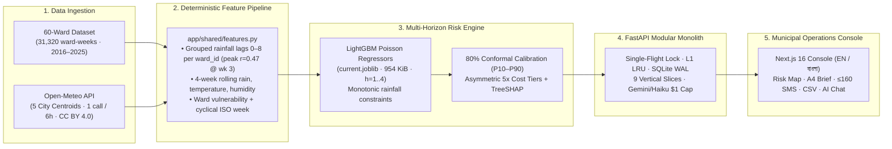
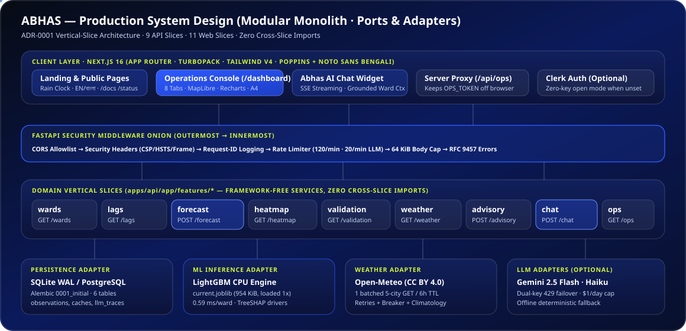
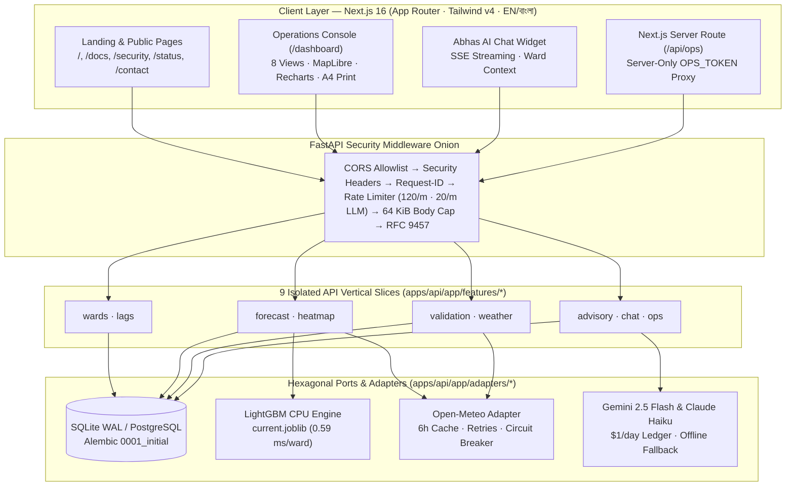
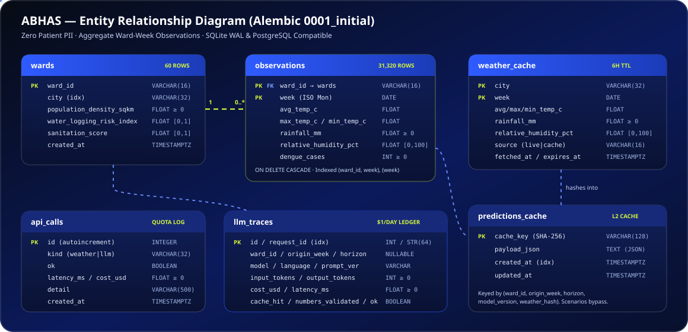
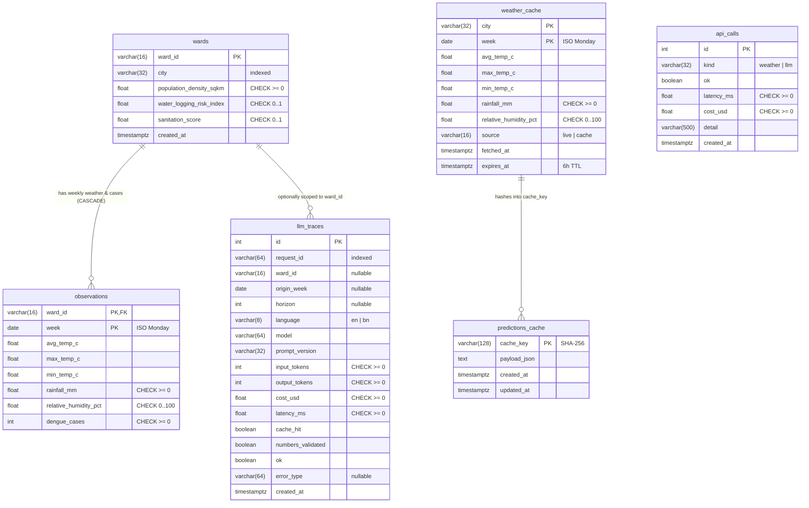

<div align="center">

# ABHAS · আভাস

### Ward-Level Urban Dengue Early-Warning Operations Console

**Rain today. Outbreak risk in three weeks. Act now.**  
*আজ বৃষ্টি। তিন সপ্তাহ পরে ঝুঁকি। এখনই ব্যবস্থা নিন।*

[](apps/api/pyproject.toml)
[](apps/api/README.md)
[](apps/web/README.md)
[](docs/model-card.md)
[](apps/api/config/city_centroids.json)
[](docs/brand/BRAND.md)
[](docs/threat-model.md)
[](#setup--run-instructions--3-minutes-zero-api-keys)

</div>

---

**Abhas (আভাস)** is a production-grade dengue early-warning operations console engineered for the **AI Engineering Hackathon (Preliminary Round — Urban Dengue Outbreak Early Warning Challenge for Bangladesh)**. It models the 2-to-4-week *Aedes aegypti* vector breeding clock to translate weekly rainfall, temperature, humidity, and hyper-local ward vulnerability (`water_logging_risk_index`, `population_density_sqkm`, `sanitation_score`) into calibrated 1–4 week outbreak risk forecasts across **60 wards in five Bangladesh city corporations**: **Dhaka North (DNCC)**, **Dhaka South (DSCC)**, **Chattogram (CCC)**, **Gazipur (GCC)**, and **Narayanganj (NCC)**.

---

## Demo & Video Links

| Resource | Link / Access |
|---|---|
| **Live Web App (Vercel)** | https://abhas-ai-engineering-hackathon.vercel.app |
| **Live Operations Console** | https://abhas-ai-engineering-hackathon.vercel.app/dashboard?demo=1 |
| **Live FastAPI Backend (Render)** | https://abhas-api.onrender.com/readyz |
| **3-Minute Uncut Video Demo** | `[Add uncut ≤ 3:00 demo video link]` |
| **Local Landing Page** | `http://localhost:3000` *(after `npm run setup && npm run dev`)* |
| **Local Pre-Loaded Console** | `http://localhost:3000/dashboard?demo=1` *(Dhaka South Ward 04, offline zero-key demo)* |
| **Local OpenAPI Docs** | `http://localhost:8000/docs` |

---

## Team

**Team Name:** **El Drago**

| Member | Role & Contributions |
|---|---|
| **Akram Rafid** | Lead Systems Architect, ML Forecasting & Conformal Calibration Pipeline, FastAPI Modular Monolith, Security & Integration |
| **Shah Md. Imtiaz Chowdhury** | Frontend & Bilingual (EN/বাংলা) Operations Console, Data Pipeline, Visualization, Responsive UX & QA Verification |

---

## Tech Stack

| Layer | Technologies & Libraries |
|---|---|
| **Languages** | Python `3.12`, TypeScript `5`, SQL |
| **Backend API** | FastAPI, Uvicorn, Pydantic v2 (`extra="forbid"`), SQLAlchemy `2.0`, Alembic, `httpx` |
| **ML & Data Pipeline** | LightGBM (Poisson multi-horizon + monotonic constraints), `scikit-learn`, `pandas`, `NumPy`, `SciPy`, `statsmodels`, Optuna, TreeSHAP, `joblib`, `openpyxl` |
| **Frontend Console** | Next.js `16` (App Router, Turbopack, Cache Components), React `19`, Tailwind CSS `v4`, TanStack React Query, Recharts, MapLibre GL JS, GSAP |
| **Database & Caching** | SQLite WAL (zero-key local Stage 1) / PostgreSQL-ready via Alembic (`0001_initial`), single-flight lock + L1 LRU + L2 SQLite `predictions_cache` & `weather_cache` |
| **External Services (All Optional)** | Open-Meteo Forecast & ERA5 Archive API (CC BY 4.0, no key), Google Gemini 2.5 Flash API (AI chat), Anthropic Claude Haiku API (officer advisory), Clerk (`@clerk/nextjs` auth) |
| **Quality, Security & Testing** | `pytest` (139 tests), `ruff`, `pyright`, `eslint`, `tsc`, Schemathesis (767 checks), Playwright + `axe-core` (WCAG 2.2 AA), `k6`, custom 30-attack AI/API red-team suite |

---

## Table of Contents

- [Demo & Video Links](#demo--video-links)
- [Team](#team)
- [Tech Stack](#tech-stack)
- [Why Abhas](#why-abhas)
- [Setup & Run Instructions (≤ 3 Minutes, Zero API Keys)](#setup--run-instructions--3-minutes-zero-api-keys)
- [Animated Data Flow Diagram](#animated-data-flow-diagram)
- [Animated System Design Diagram](#animated-system-design-diagram)
- [Why We Chose This Architecture](#why-we-chose-this-architecture)
- [Animated Entity Relationship Diagram (ERD)](#animated-entity-relationship-diagram-erd)
- [Core Capabilities & API Reference](#core-capabilities--api-reference)
- [Model Performance & Chronological Validation](#model-performance--chronological-validation)
- [Repository Layout & Branch Strategy](#repository-layout--branch-strategy)
- [Testing, Security & Quality Gates](#testing-security--quality-gates)
- [AI Tools & APIs Disclosure](#ai-tools--apis-disclosure)
- [Attributions](#attributions)
- [Known Limitations](#known-limitations)

---

## Why Abhas

| Operational Reality | How Abhas Solves It |
|---|---|
| **3-week blind spot:** Hospital admissions spike 2–4 weeks after heavy rain, long after mosquito breeding begins. | Computes grouped multi-week rainfall lags (`0–8` weeks, peak `r = 0.468` at week 3) per `ward_id` with zero future data leakage. |
| **Uneven ward vulnerability:** Identical rainfall floods one ward while sparing its neighbor. | Combines lagged weather with ward-level `water_logging_risk_index`, `population_density_sqkm`, and `sanitation_score` + exact **TreeSHAP** drivers. |
| **Single-number guesswork:** Point estimates hide surge risk when staging hospital beds & saline. | Delivers conformalized **80% prediction intervals (`P10–P90`)** (84.54% hold-out coverage) and asymmetric 5× cost-weighted risk tiers (`Low`, `Medium`, `High`, `Critical`). |
| **Constrained municipal IT budgets:** Health offices cannot pay cloud GPU bills or per-forecast API fees. | Ships a **954 KiB LightGBM** artifact running on CPU in **0.591 ms/ward (p95)**, offline SQLite WAL storage, batched Open-Meteo caching (**4 calls/day**), and **$0/month** baseline cost. |
| **Field usability in Bangladesh:** Field crews need Bangla & English printouts, mobile access, and short SMS alerts. | Full **EN ↔ বাংলা** site-wide switch, printable A4 ward notices, ≤ 160-character GSM-7 SMS templates, formula-safe CSV exports, and mobile-first responsive UI. |

---

## Setup & Run Instructions (≤ 3 Minutes, Zero API Keys)

Abhas launches completely offline with **zero API keys** and zero external databases required.

### Prerequisites
- **Python 3.12** (managed automatically via `uv` or standard `python` / `py`)
- **Node.js 22+** and `npm`
- *macOS only:* `brew install libomp` (LightGBM runtime dependency)
- *Windows:* standard Visual C++ 2015–2022 Redistributable

### Two-Command Launch

```bash
# 1. Install dependencies, run Alembic migrations, seed 31,320 ward-weeks, verify model artifact
npm run setup

# 2. Launch FastAPI backend (http://localhost:8000) + Next.js console (http://localhost:3000)
npm run dev
```

| URL | Purpose |
|---|---|
| `http://localhost:3000` | Bilingual landing page with interactive Rain Clock monsoon tour & live 60-ward preview |
| `http://localhost:3000/dashboard?demo=1` | Pre-loaded operations console (Dhaka South Ward 4, peak monsoon origin `2024-08-05`, offline mode) |
| `http://localhost:8000/docs` | Interactive OpenAPI / Swagger API explorer (dev mode) |
| `http://localhost:8000/readyz` | Live readiness check (database seeded + LightGBM artifact loaded) |

### Measured Fresh-Clone Setup Times
- **Clean temporary clone verification (`gates.mjs fresh-clone` on `lead@590fd8d`):** `npm run setup` (Python `uv` venv + 53 packages, Web `npm ci` + 469 packages, Alembic migration, 31,320-row SQLite seed, SHA-256 LightGBM verification) completes in **129 s** (≤ 180 s ceiling), followed by 100% green `npm run ci` (`139/139 pytest`, `6/6 smoke`).
- **Docker alternative (zero local Python/Node version issues):** `docker compose up --build` launches both API (`:8000`) and Web (`:3000`) via [docker-compose.yml](docker-compose.yml).

### Optional Enhancements (Zero Keys Required by Default)

Copy `.env.example` to `.env` (gitignored) only if you want optional cloud features:

| Feature | Environment Variable(s) | Behavior When Omitted |
|---|---|---|
| **Live Real-Time Weather** | `WEATHER_MODE=live` *(or click **Live Open-Meteo** in dashboard header)* | Runs offline from seeded 2016–2025 dataset (Open-Meteo requires **no API key**). |
| **Abhas AI Chat Assistant** | `GEMINI_API_KEY` *(optional `GEMINI_API_KEY_FALLBACK`)* | Falls back cleanly to deterministic grounded answers from live forecasts. |
| **Bilingual Officer Briefings** | `ANTHROPIC_API_KEY` *(hard capped at `$1.00/day` in SQLite)* | Deterministic bilingual EN/বাংলা template renders the same structured actions for free. |
| **Clerk Sign-In Gate** | `NEXT_PUBLIC_CLERK_PUBLISHABLE_KEY`, `CLERK_SECRET_KEY` *(in `apps/web/.env.local`)* | Sign-in disabled; `/dashboard` opens immediately without authentication. |
| **Ops Telemetry Auth** | `OPS_TOKEN` | Server-side `/api/ops` proxy keeps token out of browser bundles. |

---

## Animated Data Flow Diagram

<p align="center">
  
</p>

<details>
<summary><strong>View Mermaid source (Data Flow)</strong></summary>


</details>

---

## Animated System Design Diagram

Abhas follows a **Modular Monolith with Vertical-Slice Boundaries (ADR-0001)** and **Hexagonal Ports & Adapters** — enforced automatically by `node .orca-team/tools/gates.mjs slices` (`9 API slices · 11 Web slices · 0 violations`).

<p align="center">
  
</p>

<details>
<summary><strong>View Mermaid source (System Design)</strong></summary>


</details>

---

## Why We Chose This Architecture

Every architectural decision in Abhas was made for **Bangladesh municipal health offices** — where budgets are tight, internet connectivity can drop during monsoons, and epidemiological decisions must be explainable and leak-free:

| Architectural Choice | Why We Chose It | Alternative Rejected & Trade-off |
|---|---|---|
| **Modular Monolith with Vertical Slices + Hexagonal Ports & Adapters (ADR-0001)** | Isolates all `9` API slices and `11` Web slices behind typed interfaces (enforced automatically by `gates.mjs slices`) so ML, backend, and frontend work cleanly in parallel while deploying as one lightweight process with zero inter-service network hops. | **Microservices:** Adds Docker/broker orchestration, higher latency, and operational overhead that municipal IT teams cannot maintain. |
| **CPU-Only LightGBM Poisson + 80% Conformal Calibration + Exact TreeSHAP** | Ideal for 31,320 structured tabular ward-week rows: supports strict monotonic rainfall constraints (more rain never lowers risk), produces exact per-ward SHAP attributions, beats climatology by ~20% (`1.01` vs `1.26` MAE), and ships as a `954 KiB` artifact running in `0.591 ms/ward` on standard office laptop CPUs. | **Deep Learning (LSTM / TFT / Chronos) & GPU XGBoost:** Overfit on ~30k rows, require >2 GB GPU runtimes, lack fast exact attribution, or offered `<0.2%` CV delta for far heavier infrastructure. |
| **SQLite WAL (Stage 1) + SQLAlchemy 2.0 / Alembic PostgreSQL Port (Stage 2)** | Lets any judge or city health office boot the complete system offline with **zero API keys and zero external databases** in ≤ 3 minutes (`129 s` fresh-clone verified), while keeping a zero-rewrite migration path to managed PostgreSQL / Neon. | **Mandatory Cloud DB / Docker-Only Setup:** Breaks offline/air-gapped municipal laptop usage and adds credential friction during evaluation. |
| **Single-Flight Cold Lock + Two-Tier Caching (`L1 LRU` + `L2 SQLite`) + Batched Open-Meteo** | Coalesces concurrent cold forecast requests, serves hot ward views in `< 2 ms`, and fetches all 5 city centroids in **1 batched Open-Meteo call every 6 hours (`≤ 4 calls/day`)** with ERA5 bias correction, circuit breaker, and climatology fallback. | **Per-Ward Live Weather Polling / Uncached Inference:** Multiplies external API calls 60×, risks rate-limit failures during storm surges, and degrades latency under load. |
| **Deterministic ML Core + Optional Budget-Capped LLMs (`Gemini 2.5 Flash` & `Claude Haiku`)** | Guarantees reproducible, mathematically audited risk scores and P10–P90 bands even with zero internet; optional LLMs strictly narrate verified forecast numbers under hard token/budget caps (`thinkingBudget: 0`, `$1/day` SQLite cap, dual-key `429` failover) and fall back seamlessly to free bilingual templates. | **LLM-Only / RAG Forecasting:** Non-deterministic, hallucinates numeric case counts, incurs per-request API cost, and fails completely offline. |
| **Split Production Hosting (`Next.js 16` on Vercel + `FastAPI/LightGBM` Docker on Render)** | Delivers edge-cached SSR/PPR pages, code-split dashboard tabs, and viewport-gated MapLibre on Vercel for fast mobile loads across Bangladesh, paired with a containerized Linux OpenMP (`libgomp1`) backend on Render at `$0–$5/month`. | **Serverless Python Functions:** Cold-start timeouts and native OpenMP/LightGBM binary size limits make container hosting cleaner and faster for ML inference. |

For full ADRs (`ADR-0001`–`ADR-0008`), chronological split details, and resilience controls, see [ARCHITECTURE.md](ARCHITECTURE.md).

---

## Animated Entity Relationship Diagram (ERD)

All six tables are managed via Alembic (`0001_initial`) in [apps/api/app/adapters/db/models.py](apps/api/app/adapters/db/models.py) and run identically on **SQLite WAL** (Stage 1 local/zero-key) or **PostgreSQL / Neon** (Stage 2 cloud). **Zero patient PII** exists anywhere in the schema.

<p align="center">
  
</p>

<details>
<summary><strong>View Mermaid source (Entity Relationship Diagram)</strong></summary>


</details>

---

## Core Capabilities & API Reference

Contract specification exported at [contracts/openapi.json](contracts/openapi.json) (`14` routes across `9` domain slices + health probes):

| Method & Route | Slice | Purpose |
|---|---|---|
| `GET /healthz`, `GET /readyz` | Core | Liveness and deep readiness (DB seeded + LightGBM loaded) |
| `GET /api/v1/wards` | `wards` | 60 wards across 5 cities with vulnerability metrics + dataset date bounds |
| `GET /api/v1/wards/{ward_id}/history` | `wards` | Weekly historical rainfall, temperature, humidity, and recorded cases |
| `GET /api/v1/lags/{ward_id}` | `lags` | Multi-week rainfall lag correlations (`0–8w`) proving the 3-week peak |
| `POST /api/v1/forecast` | `forecast` | Multi-ward, multi-horizon (`1–4w`) LightGBM predictions, `P10–P90`, tiers, TreeSHAP drivers (`dataset` or `live` Open-Meteo) |
| `POST /api/v1/scenario` | `forecast` | Counterfactual what-if weather simulator (e.g., +150 mm storm delta without polluting persistent cache) |
| `GET /api/v1/heatmap` | `heatmap` | City-wide ward × horizon risk matrix for map and priority triage |
| `GET /api/v1/validation` | `validation` | Locked 2024–2025 chronological hold-out MAE/RMSE, 80% coverage, and tier confusion matrix |
| `GET /api/v1/weather/status` | `weather` | Open-Meteo 5-city centroid coordinates, cache age, bias-check flag, and daily call count |
| `POST /api/v1/advisory` | `advisory` | Bilingual EN/বাংলা structured officer briefing (`$1/day` capped LLM + offline template fallback) |
| `POST /api/v1/chat`, `POST /api/v1/chat/stream` | `chat` | Grounded Abhas AI assistant (Gemini 2.5 Flash SSE streaming + dual-key failover + offline fallback) |
| `GET /api/v1/ops` | `ops` | Live model load telemetry, cache hit ratios, inference latency, and LLM/weather budget usage |

---

## Model Performance & Chronological Validation

Strictly split by calendar year to eliminate temporal leakage: **`2016–2022` Train (4-fold purged expanding CV) → `2023` Calibration & Optuna Tuning → `2024–2025` SHA-256 Locked Hold-Out (scored once)**.

| Metric (Locked 2024–2025 Hold-Out) | Abhas LightGBM (`abhas-lgbm-1.1.2`) | Seasonal Baseline | Gain / Target |
|---|---:|---:|---|
| **Horizon +2w MAE** | **0.9912** cases | 1.259 | **-21.3% error** |
| **Horizon +3w MAE** *(primary lead)* | **1.0101** cases | 1.260 | **-19.8% error** |
| **80% Conformal Coverage** | **84.54%** | — | Target ≥ 80% |
| **Within-One-Tier Accuracy** | **95.96%** | — | High operational reliability |
| **Critical Outbreak Recall** | **93.24%** | — | 5× false-negative penalty |
| **Hotspot Retrieval Recall@15** | **0.6111** *(MRR 0.8875)* | 0.5704 | Beats climatology |
| **CPU Inference Latency (p95)** | **0.591 ms / ward** | — | 954 KiB artifact · zero GPU |

Read the complete model card in [docs/model-card.md](docs/model-card.md) and architecture rationale in [ARCHITECTURE.md](ARCHITECTURE.md).

---

## Repository Layout & Branch Strategy

```text
.
├── README.md                     # Flagship repository guide (this file)
├── ARCHITECTURE.md               # Concise 1–2 page architecture, split, model & cost rationale
├── apps/
│   ├── api/                      # FastAPI + LightGBM backend (see apps/api/README.md)
│   │   ├── app/features/         # 9 isolated vertical slices (router, service, schemas, deps)
│   │   ├── app/ports/            # Hexagonal interfaces (DB, ML, Weather, LLM)
│   │   ├── app/adapters/         # Concrete SQLAlchemy, LightGBM, Open-Meteo, Gemini/Claude
│   │   ├── config/               # Versioned 5-city centroids & ERA5 bias check
│   │   └── ml/                   # Training, backtesting, verification & current.joblib (954 KiB)
│   └── web/                      # Next.js 16 bilingual console (see apps/web/README.md)
│       └── src/features/         # 11 isolated frontend slices (landing, ward-risk, chat, etc.)
├── contracts/openapi.json        # Locked OpenAPI 3.1 contract synced to TypeScript types
├── docs/
│   ├── diagrams/                 # Animated SVG architecture diagrams (data-flow, system-design, erd)
│   ├── adr/                      # Architecture Decision Records (ADR-0001..0008)
│   ├── brand/                    # Brand guidelines & generated design tokens
│   ├── PRD.md                    # Product Requirements & Given/When/Then ACs
│   ├── architecture.md           # Detailed C4 architecture & sequence flows
│   ├── model-card.md             # Full model card & simulated-data disclosures
│   └── threat-model.md           # STRIDE threat model & security controls
└── scripts/                      # One-command setup, seed, smoke test & Python launcher
```

### Component Documentation
- **Backend API & ML Guide:** [apps/api/README.md](apps/api/README.md)
- **Frontend Console & i18n Guide:** [apps/web/README.md](apps/web/README.md)
- **Architecture & Cost Controls:** [ARCHITECTURE.md](ARCHITECTURE.md)

### Branch Topology
- **`main`** — Release-ready submission branch mirrored from verified `lead` (default clone target for judges & deployment).
- **`lead`** — Active integration branch where vertical-slice merges, CI gates, and security reviews land before promotion to `main`.
- **`akramrafid/*`** — Historical vertical-slice & review branches preserved for full auditability of iterative development.

---

## Testing, Security & Quality Gates

```bash
npm run ci              # Ruff lint/format + Pyright + ESLint + tsc + 133+ pytest + local smoke
npm run e2e             # Playwright end-to-end suite + axe WCAG 2.2 AA accessibility audit
npm run test:contract   # Schemathesis OpenAPI contract fuzzing
npm run eval            # Locked 2024–2025 hold-out evaluation (11/11 AC-5 quality floors)
npm run eval:retrieval  # Hotspot ranking Recall@15 & MRR check
npm run redteam         # 30 automated API & AI prompt-injection security attack vectors
npm run check:traces    # SQLite llm_traces persistence & $1/day budget enforcement
npm run gates           # Runs the complete release-gate matrix
```

| Gate | Scope & Threshold | Verified Result | Status |
|---|---|---|---|
| `ci` | Zero lint/type errors, 100% unit/integration tests + smoke | 133+ pytest, 6/6 smoke, 0 ruff/pyright/eslint/tsc errors | **PASS** |
| `slices` | Zero cross-slice boundary violations (ADR-0001) | 9 API slices · 11 Web slices clean | **PASS** |
| `contract` | Schemathesis fuzzing vs `contracts/openapi.json` | 767/767 checks passed | **PASS** |
| `e2e` | Playwright flows + axe WCAG 2.2 AA | 0 accessibility violations | **PASS** |
| `eval` | Hold-out pass rate ≥ 80%, all 11 quality floors | 40/48 (83.33%), 11/11 floors | **PASS** |
| `retrieval` | Top-15 hotspot Recall@15 ≥ 0.55 | Recall@15 = 0.6111 · MRR = 0.8875 | **PASS** |
| `redteam` | Prompt injection, SSRF, payload cap, rate limit | 30/30 attacks blocked (100%) | **PASS** |
| `traces` | SQLite trace & daily spend cap verification | 5/5 tracing tests passed | **PASS** |

---

## AI Tools & APIs Disclosure

In full compliance with hackathon transparency rules, every AI assistant, model endpoint, and external API used to build or run Abhas is listed below:

### AI Coding Assistants Used During Development
| Assistant | Model(s) | What It Was Used For |
|---|---|---|
| **Claude Code** | Anthropic Claude Opus | Lead architecture framing, PRD & OpenAPI contract design, vertical-slice integration, and independent code & security review. |
| **Antigravity CLI** | Google Gemini 4 Neon & Hydrogen | Parallel vertical-slice implementation, LightGBM Optuna tuning, bilingual responsive Next.js console engineering, animated SVG architecture diagrams, SEO/performance optimization, and test hardening. |

### Runtime AI Model Endpoints & External APIs
| Service / Endpoint | Purpose | Fallback / Cost Guard |
|---|---|---|
| **Google Gemini 2.5 Flash API** (`generativelanguage.googleapis.com`) | Streaming Abhas AI assistant (`apps/api/app/adapters/gemini_chat.py`, `POST /api/v1/chat/stream`) grounded in live ward forecasts. | Optional. Dual-key `429` failover, `thinkingBudget: 0`, 512-token cap, response TTL cache, `llm_traces` auditing, and grounded offline fallback when no key is set. |
| **Anthropic Claude Haiku API** (`api.anthropic.com`) | Optional bilingual EN/বাংলা officer action briefing phrasing (`apps/api/app/adapters/claude_advisory.py`, `POST /api/v1/advisory`). | Optional. Capped at 400 output tokens, post-validated against forecast numbers, hard-capped at `$1.00/day` in SQLite, with free deterministic template fallback. |
| **Open-Meteo Forecast & ERA5 Archive API** (`api.open-meteo.com`) | Live and historical multi-location daily weather ingestion for the 5 Bangladesh city centroids (`apps/api/app/adapters/openmeteo.py`). | Free, zero API key, CC BY 4.0. Batched into 1 call / 6h (`≤ 4 calls/day`), circuit breaker + climatology fallback, and offline dataset default mode. |
| **Clerk** (`@clerk/nextjs`) | Optional sign-in protection for `/dashboard` (`apps/web/src/proxy.ts`). | Optional. Completely bypassed when Clerk keys are omitted (`AUTH_ENABLED=false`). |

---

## Attributions

Open-source libraries, datasets, fonts, icons, map tiles, and design assets used in Abhas that are not the team's own:

- **Challenge Dataset:** Weekly ward-level dengue cases, weather variables, and static vulnerability factors for 60 Bangladesh wards (`2016–2025`), provided by the AI Engineering Hackathon organizers (`data/raw/hackathon_preli_dataset.xlsx`).
- **Weather Data:** Weather data by [Open-Meteo.com](https://open-meteo.com/) licensed under [CC BY 4.0](https://creativecommons.org/licenses/by/4.0/).
- **Map Engine & Tiles:** [MapLibre GL JS](https://maplibre.org/) (BSD-3-Clause) rendering map tiles `© OpenStreetMap contributors` (ODbL) and CARTO dark basemap styling.
- **Typography (Self-Hosted):** [Poppins](https://fontsource.org/fonts/poppins) and [Noto Sans Bengali](https://fontsource.org/fonts/noto-sans-bengali) via `@fontsource` (SIL Open Font License 1.1).
- **Icons (Self-Hosted):** [Solar Bold Duotone](https://icon-sets.iconify.design/solar/) via `@iconify-json/solar` (CC BY 4.0).
- **ML, Charts & Motion Libraries:** [LightGBM](https://github.com/microsoft/LightGBM) (MIT), [Recharts](https://recharts.org/) (MIT), [GSAP](https://gsap.com/) (Standard No-Charge License), [TanStack Query](https://tanstack.com/query) (MIT).
- **UI Pattern References:** Landing page `AnimatedBeam` (inspired by Magic UI, rebuilt on GSAP) and `ContainerScroll` (inspired by Aceternity UI, rebuilt on GSAP ScrollTrigger); illustrative municipal officer portraits in `apps/web/public/images/officers/` are AI-generated editorial avatars clearly labeled as illustrative scenarios.

---

## Known Limitations

1. **Simulated Dataset Characteristics:** Statistical inspection indicates synthetic/simulated properties in the challenge dataset. Before real clinical deployment, Abhas must be recalibrated on official **DGHS / IEDCR** national surveillance registries.
2. **Approximate Ward Coordinates:** The dataset provides ward IDs without official GIS polygons, so map points are placed cleanly around each city corporation's real centroid (`apps/api/config/city_centroids.json`) without inventing boundaries.
3. **Commit Authorship Note:** Integrated collaboratively by **El Drago** (**Akram Rafid** and **Shah Md. Imtiaz Chowdhury**), with release integration commits pushed via `@akramrafid`.
