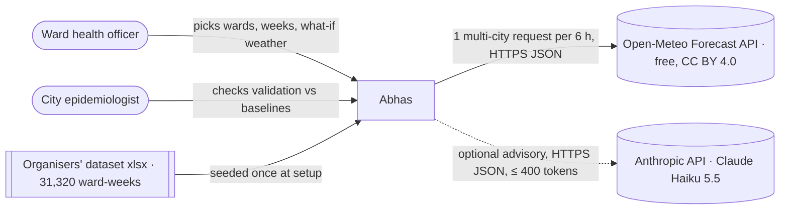
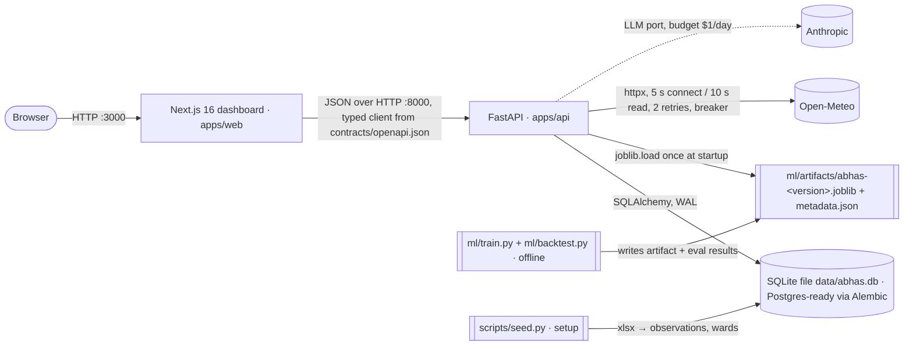

# Architecture — Abhas (dengue early warning)

Abhas is a modular monolith: one FastAPI service (Python 3.12) and one Next.js 16 dashboard, run locally with
two commands. Inside the API, each product capability is a **vertical slice** (`app/features/<name>/`), and
every outside dependency (weather provider, trained model, LLM, database) sits behind a **port** with a real and
a fake adapter (ADR-0001). Archetype: **prediction service + analytics dashboard** (tabular forecasting with an
explainability layer); the optional advisory adds a small structured-output LLM step. No RAG, no vector store.

## Context (C4 L1)

## Containers (C4 L2)

### Inside the API (one slice per capability)
| Slice | Routes | Owner | Uses |
|---|---|---|---|
| `wards` | GET /api/v1/wards, /wards/{id}/history | DATA | ObservationRepository |
| `lags` | GET /api/v1/wards/{id}/lags | DATA | ObservationRepository, `shared/features.py` |
| `forecast` | POST /api/v1/forecast, /api/v1/scenario | CORE | ForecastModel, WeatherSource, PredictionCache |
| `heatmap` | GET /api/v1/heatmap | CORE | same as forecast (shared service code in `shared/`) |
| `validation` | GET /api/v1/validation | CORE | stored backtest results (`evals/results/`) |
| `weather` | GET /api/v1/weather/status | DATA | WeatherSource, CallLog |
| `advisory` | POST /api/v1/advisory | CORE | LLM port (fake when no key), PredictionCache |
| `ops` | GET /api/v1/ops | CORE | counters, CallLog |

`app/shared/features.py` is **the** feature builder, imported by training, backtest and serving, so there is
no train/serve skew. `app/shared/tiers.py` and `app/shared/drivers.py` hold tier cut-offs and the SHAP-to-driver
grouping. Contracts (`features/*/schemas.py`, `ports/`, `core/types.py`) are owned by LEAD.

## Deployment
| Container | Platform | Config | State |
|---|---|---|---|
| web | `npm run dev` (Next.js dev server) or `next build && next start`, localhost:3000 | `NEXT_PUBLIC_API_BASE_URL` | none (browser cache only) |
| api | `python -m app` (uvicorn), localhost:8000 | `.env` (all optional) | SQLite file `data/abhas.db` (created by `alembic upgrade head` + seed) |
| model | committed joblib artifact, SHA-256 checked at setup | `MODEL_PATH` | read-only file |
| Stage 2 (final sprint) | same containers; `DATABASE_URL` → Postgres; live weather on a schedule | — | Postgres |

Run: `npm run setup` (uv if present, else venv + pip; `npm ci`; migrate; seed; artifact check) then `npm run dev`.
Deploy to Vercel is out of scope for this round (ADR-0002); it needs the human's approval.

## Key flows
Sequence diagrams, the resilience register, latency budget and rate limits are in `docs/system-design.md`
(DESIGN seat). Data pipeline and lag features: `docs/data-pipeline.md` (DATA). Model, evaluation and tiers:
`docs/ai-design.md` (CORE).

## Decisions
`docs/adr/`: 0001 vertical slices · 0002 SQLite + Alembic, local run · 0003 LightGBM Poisson direct multi-horizon ·
0004 chronological validation and uncertainty · 0005 weather source and caching · 0006 advisory LLM ·
0007 dashboard stack and data fetching · 0008 request/response, no auth.
