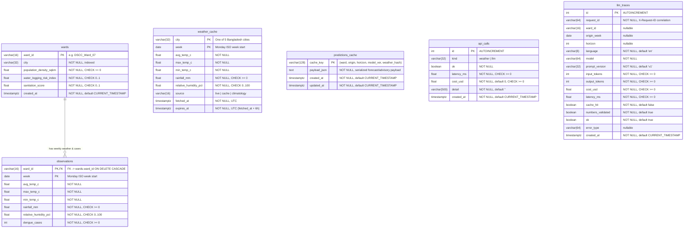

# Data Model — Abhas (আভাস)

_Owner: DATA (Role 7 — Database Engineer) · Updated: 2026-11-21 · Migration revision: `0001_initial`_

Abhas stores state in a local SQLite database (`data/abhas.db`) managed by SQLAlchemy 2.0 and Alembic (`apps/api/migrations/`), configured with SQLite WAL mode for concurrent reads and designed to run unchanged against PostgreSQL in Stage 2 by swapping `DATABASE_URL` (ADR-0002).

## Entity-Relationship Diagram

## Table Specifications & Constraints

| Table | Primary Key | Foreign Keys | Domain Constraints (`CHECK`) | Row Volume (Stage 1) |
|---|---|---|---|---|
| `wards` | `(ward_id)` | — | `population_density_sqkm >= 0`, `water_logging_risk_index BETWEEN 0 AND 1`, `sanitation_score BETWEEN 0 AND 1` | 60 rows |
| `observations` | `(ward_id, week)` | `ward_id -> wards.ward_id` (`ON DELETE CASCADE`) | `rainfall_mm >= 0`, `relative_humidity_pct BETWEEN 0 AND 100`, `dengue_cases >= 0` | 31,320 rows (60 × 522) |
| `weather_cache` | `(city, week)` | — | `rainfall_mm >= 0`, `relative_humidity_pct BETWEEN 0 AND 100` | ~80 rows (5 cities × ~16 weeks) |
| `predictions_cache` | `(cache_key)` | — | — | Bounded by active origins & hot LRU |
| `api_calls` | `(id)` | — | `latency_ms >= 0`, `cost_usd >= 0` | ≤ 4 weather calls/day + optional LLM |
| `llm_traces` | `(id)` | — | `input_tokens >= 0`, `output_tokens >= 0`, `cost_usd >= 0`, `latency_ms >= 0` | Optional advisory calls (COULD) |

All constraint names follow a deterministic SQLAlchemy `MetaData(naming_convention=...)` so Alembic autogenerate (`alembic check`) detects zero model drift.

## Index Catalog

| Index Name | Table | Columns | Query / Demo Path Served |
|---|---|---|---|
| `ix_wards_city` | `wards` | `(city)` | `GET /api/v1/wards?city=...`, city heatmap ward lookup, Open-Meteo city climatology |
| `ix_observations_ward_id_week` | `observations` | `(ward_id, week)` | `GET /api/v1/wards/{ward_id}/history`, `GET /api/v1/wards/{ward_id}/lags`, per-ward lag feature slicing `week <= origin_week` |
| `ix_observations_week` | `observations` | `(week)` | `ObservationRepository.date_range()` (`MIN/MAX(week)`), cross-ward origin-week slicing for city heatmaps & backtests |
| `ix_weather_cache_city_week` | `weather_cache` | `(city, week)` | Live weather lookups per city and ISO week |
| `ix_weather_cache_expires_at` | `weather_cache` | `(expires_at)` | 6-hour TTL freshness check and stale-cache fallback queries |
| `ix_predictions_cache_created_at` | `predictions_cache` | `(created_at)` | Cache audit, pruning, and ops statistics |
| `ix_api_calls_kind_created_at` | `api_calls` | `(kind, created_at)` | `CallLog.today(kind)` (since `00:00 Asia/Dhaka`) for `/api/v1/weather/status`, `/api/v1/ops`, and the `$1/day` LLM budget guard |
| `ix_llm_traces_created_at` | `llm_traces` | `(created_at)` | LLMOps trace inspection and daily spend/latency rollups |
| `ix_llm_traces_request_id` | `llm_traces` | `(request_id)` | Correlating structured HTTP logs (`X-Request-ID`) to advisory LLM traces |

## Connection, Concurrency & Stage-2 Postgres Parity

- **Engine configuration (`apps/api/app/adapters/db/engine.py`)**:
  - Relative SQLite URLs (e.g. `sqlite:///./data/abhas.db`) are normalized against `REPO_ROOT` so CLI scripts (`alembic`, `scripts.seed`) and the FastAPI server always resolve to the same file regardless of working directory.
  - On every SQLite connection, an `event.listen(engine, "connect")` hook executes:
    - `PRAGMA journal_mode=WAL` (concurrent readers without blocking on writes)
    - `PRAGMA busy_timeout=15000` (15 s lock wait for k6 20-VU load spikes)
    - `PRAGMA foreign_keys=ON` (enforces `observations.ward_id -> wards.ward_id`)
    - `PRAGMA synchronous=NORMAL` (safe and fast under WAL)
- **Hot in-memory caching**: `SqlPredictionCache` maintains a thread-safe LRU cache over `predictions_cache`, avoiding SQLite read/write pressure on repeated forecast requests.
- **Postgres compatibility**:
  - All column types (`String`, `Float`, `Integer`, `Boolean`, `Date`, `DateTime(timezone=True)`, `Text`), `CURRENT_TIMESTAMP` server defaults, explicit named constraints, and dialect-aware `ON CONFLICT ... DO UPDATE` upserts work on both SQLite 3.24+ and PostgreSQL 14+.
  - `migrations/env.py` enables `render_as_batch=True` only on SQLite and converts `postgres://` to `postgresql://` automatically.
  - No `Base.metadata.create_all()` is used anywhere in production or runtime paths; all schema changes go exclusively through Alembic revisions.

## Migration Verification

Reversibility and zero ORM drift are enforced by `apps/api/scripts/db_check.py` (invoked by `npm run db:check` and `node .orca-team/tools/gates.mjs migrations`):

1. Creates an isolated temporary empty SQLite file.
2. Runs `alembic upgrade head`.
3. Runs `alembic check` to verify ORM models in `app/adapters/db/models.py` match the migration revision with zero diff.
4. Inspects tables, primary keys, foreign keys, indexes, and SQLite `WAL` / `foreign_keys` pragmas.
5. Runs `alembic downgrade base` and asserts zero user tables remain.
6. Runs `alembic upgrade head` again and asserts all 6 tables are recreated cleanly.
