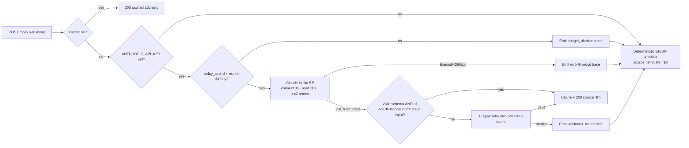

# LLMOps — Abhas (আভাস)

_Owner: CORE (Role 15 · LLMOps / SRE) · Updated: 2026-11-21_
_Traceability: `docs/PRD.md` (AC-10, AC-17, NFR-1, NFR-2, NFR-7) · `docs/system-design.md` (§5–§8) · `docs/adr/0006-advisory-llm.md`_

Abhas runs offline with zero API keys by default (`POST /api/v1/advisory` uses deterministic EN/BN templates). When `ANTHROPIC_API_KEY` is configured, every Anthropic Messages API attempt goes through `app/adapters/llm.py` (`AnthropicLLM`), emits one structured `LLMCallRecord` per SDK invocation via `app/observability/traces.py`, updates in-process counters (`app/observability/metrics.py`), persists to SQLite `llm_traces` and `api_calls`, and is surfaced at `GET /api/v1/ops`.

## SLOs

| Signal | Target | Measured by |
|---|---|---|
| Availability (non-5xx across `/api/v1/*`) | ≥ 99% during demo & 20-VU load | `GET /api/v1/ops`, `npm run load` (k6) |
| Model inference latency per ward (NFR-1) | p95 < 50 ms (4 horizons) | `GET /api/v1/ops` (`predictions.p95_ms`), `npm run eval` |
| End-to-end API latency under 20 VUs (NFR-2) | p95 < 300 ms, error rate < 1% | `npm run load` |
| Advisory response latency (template default) | p95 < 50 ms | structured JSON request logs (`duration_ms`) |
| Advisory LLM latency (uncached, Haiku 5.5) | p95 < 3.0 s (hard timeout 20 s) | `llm_traces.latency_ms`, `StdoutSink` JSON |
| Advisory numeric grounding rate (AC-17) | 100% (`numbers_validated == true`) | `llm_traces.numbers_validated`, `test_ac_17_*` |
| Model singleton invariant (AC-10, NFR-7) | `model_loads == 1` per process | `GET /api/v1/ops` (`model_loads`) |
| External weather call ceiling (AC-15, NFR-7) | ≤ 1 multi-city Open-Meteo call / 6 h | `GET /api/v1/ops` (`weather.calls_today`), `api_calls` |

### Tracing contract (`app/observability/traces.py`)
- Every SDK attempt (success, timeout, error, repair retry) emits exactly one `LLMCallRecord` carrying `ts`, `request_id`, `route`, `feature`, `prompt_name`, `prompt_version`, `provider`, `model`, `attempt`, `fallback_used`, `status`, `latency_ms`, `tokens_in`, `tokens_out`, `cost_usd`, `cache_hit`, `numbers_validated`, `error_type`, `ward_id`, `origin_week`, `horizon`, and `language`.
- **Sinks (`FanOutSink`)**:
  - `StdoutSink` — structured JSON line (`{"type": "llm_call", ...}`) on stdout (never logs raw prompts or PII).
  - `SqlLlmTraceSink` — writes to SQLite/Postgres `llm_traces`; failures are caught and logged at `WARN` so tracing never breaks a user request.
  - `MemorySink` — active in `APP_ENV=test` for machine-checked assertions (`npm run check:traces` verifies `records == SDK invocations`).

## Budget

Token rates are stored in `apps/api/app/observability/pricing.json` (`source` + `checked` fields; unknown models return `None` with a `WARN` log and are never guessed).

| Control | Configured value | Enforcement point |
|---|---|---|
| Default mode (no key) | **$0.00 / day** | `Settings.llm_enabled == False` → deterministic EN/BN template |
| Daily LLM spend cap (`LLM_DAILY_BUDGET_USD`) | **$1.00 / day** (Asia/Dhaka midnight reset) | Pre-flight `AnthropicLLM._check_budget()` against `SqlCallLog.today("llm")` |
| Per-call output cap (`LLM_MAX_OUTPUT_TOKENS`) | **≤ 400 tokens** (hard ceiling `400`) | Passed to `messages.create(max_tokens=...)` and clamped in `AnthropicLLM` |
| Per-call input cap | **≤ 4,800 chars** (~1,200 tokens) | Clamped in `AnthropicLLM.complete_json()` |
| Advisory rate limit (when LLM enabled) | **20 req/min / IP** | `RateLimitMiddleware` (`app/core/ratelimit.py`) |
| Advisory cache | Keyed by `(ward_id, origin_week, horizon, model_version, language, prompt_version)` | L1 LRU + SQLite `predictions_cache` (`adv:` prefix) |
| Estimated monthly office cost (1 city, 20 wards) | **$0.00 / mo** (template) · **~$0.69 / mo** (Haiku, ~320 uncached calls @ ~$0.00215/call; hard ceiling $30/mo) | Reported live at `GET /api/v1/ops` (`est_monthly_cost_usd`) |
| Offline eval cost (`npm run eval`, `npm run eval:retrieval`) | **$0.00 / run** | Deterministic LightGBM + local dataset, zero external API calls |

## Fallback chain

- **Retries**: Initial attempt + max 2 retries (3 total) with exponential backoff + jitter (honouring `Retry-After`, clamped ≤ 10 s) on transient errors only (`TimeoutException`, `APITimeoutError`, `APIConnectionError`, HTTP `429/500/502/503/504`). Zero retries on `400/401/403/404/422` or `BudgetExceededError`.
- **Degradation**: Any unrecoverable LLM failure, schema error, ungrounded number, or budget exhaustion degrades cleanly to the deterministic EN/BN template (`HTTP 200`, `source="template"`, `numbers_validated=true`), never a 500 error.
- **Ops access control**: `GET /api/v1/ops` returns `Cache-Control: no-store`. Open read-only on localhost when `OPS_TOKEN` is unset; requires constant-time `X-Ops-Token` match (`401 application/problem+json`) whenever `OPS_TOKEN` is configured.

## Runbook

| Incident | Detection signal | Immediate action | Verification |
|---|---|---|---|
| **Anthropic provider down / timeouts** | `ops.llm.errors` rising; `llm_traces.status == "timeout"`; advisories return `source="template"` | No user outage (template fallback active). Unset `ANTHROPIC_API_KEY` to skip 20 s waits during prolonged outage, or inspect Anthropic status. | `POST /api/v1/advisory` returns 200 in < 50 ms with `source="template"`. |
| **Anthropic 429 rate limited** | `llm_traces.error_type == "RateLimitError"`; `Retry-After` logs | Verify `RateLimitMiddleware` advisory cap (`20 req/min`) and confirm advisory cache hit rate is high (`predictions_cache` working). | Subsequent identical requests return `cached=true` with zero new SDK calls. |
| **Daily cost spike / budget reached** | `ops.llm.spend_usd_today >= ops.llm.budget_usd_per_day`; `budget_blocked` traces | Budget guard automatically halts external calls at `$1.00/day` and serves template advisories. Audit `llm_traces` for high-volume IPs or cache misses. | `GET /api/v1/ops` shows `spend_usd_today` frozen; advisories stay 200 (`template`). |
| **Slow inference / latency breach (NFR-1/NFR-2)** | `ops.predictions.p95_ms >= 50` or k6 p95 ≥ 300 ms | Confirm `model_loads == 1`, verify serving LightGBM boosters run with `num_threads=1` via `asyncio.to_thread`, and check SQLite WAL (`PRAGMA journal_mode=WAL`, `busy_timeout=5000`). | `GET /api/v1/ops` shows `predictions.p95_ms < 50` and `cache_hit_rate` climbing on repeat queries. |
| **Bad / hallucinated advisory outputs** | `llm_traces.status == "validation_failed"` or user reports phrasing regression | Numeric validator automatically blocks ungrounded ASCII/Bangla digits and falls back to template. Roll back `apps/api/app/features/advisory/prompts/advisory_v1.md` to previous git revision or unset `ANTHROPIC_API_KEY`. | `npm run check:traces` and `pytest tests/features/advisory` pass; `numbers_validated == true` on all responses. |
| **Corrupt or missing model artifact** | `ModelArtifactError` (HTTP 503) on `/api/v1/forecast` or `ml.verify_artifact` non-zero exit | Re-run `node scripts/py.mjs -m ml.verify_artifact`; restore `apps/api/ml/artifacts/current.joblib` and `metadata.json` from git or re-run `npm run train`. | `ml.verify_artifact` prints `OK: verified ...` and `GET /api/v1/ops` reports `model_loads == 1`. |
