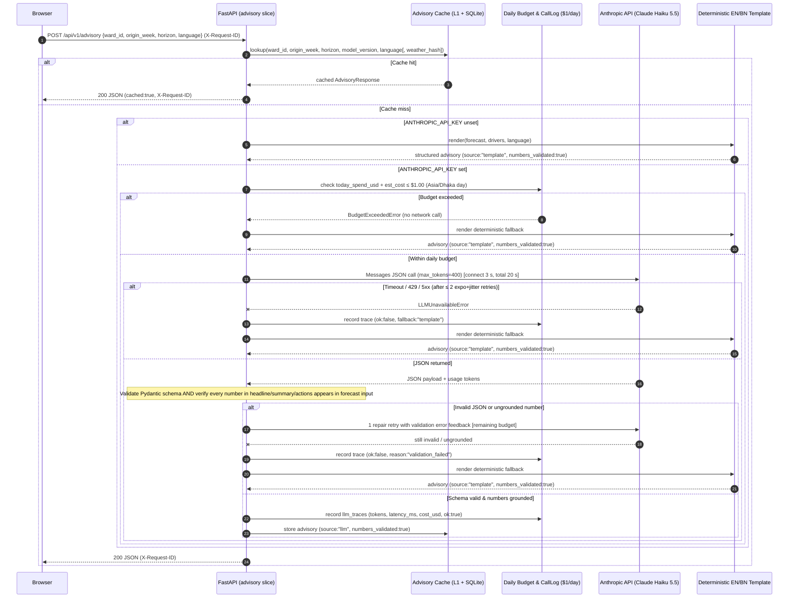

# System Design — Abhas (আভাস): Ward-Level Dengue Early Warning

_Owner: DESIGN (Role 4 · System Designer) · Updated: 2026-11-21 · Status: Wave 1A lock_
_Traceability: `docs/PRD.md` (NFR-1, NFR-2, NFR-5, NFR-7; AC-4, AC-8, AC-10, AC-15, AC-17) · `docs/architecture.md` · `docs/adr/0001..0008`_

This document specifies runtime request flows, external dependency resilience, end-to-end latency budgets, caching, rate limits and quotas, capacity and monthly office cost estimates (Rubric R6), failure modes, and the `FAULT_INJECT` test contract for CORE and DATA.

---

## 1. Sequence diagrams

### 1a. Golden path — multi-ward forecast (`POST /api/v1/forecast`, dataset mode)

Covers normal serving from the browser through Next.js and FastAPI to the L1/L2 prediction cache, SQLite observations, shared feature builder, and the once-loaded LightGBM joblib artifact. Every response carries `X-Request-ID`.

```mermaid
sequenceDiagram
  autonumber
  participant B as Browser (React + TanStack Query)
  participant W as Next.js 16 (:3000)
  participant A as FastAPI API (:8000)
  participant C as L1 LRU + SQLite predictions_cache
  participant D as SQLite DB (WAL · observations/wards)
  participant M as LightGBM joblib (in-process)

  B->>W: Load /?demo=1 (static JS + self-hosted fonts)
  W-->>B: HTML + client bundle (no SSR API call, ADR-0007)
  B->>A: POST /api/v1/forecast {ward_ids, origin_week, horizons, source:"dataset"} (X-Request-ID)
  Note over A: RequestIdMiddleware assigns X-Request-ID; RateLimit 120 req/min/IP; Body ≤ 64 KB; Pydantic validates schema
  A->>C: lookup(ward_id, origin_week, h, model_version, weather_hash) [in-process < 1 ms]
  alt L1 or L2 SQLite cache hit
    C-->>A: cached WardForecast payload
    A-->>B: 200 JSON (cached:true, weather_source:"dataset", X-Request-ID)
  else Cache miss
    A->>D: SELECT wards + 9-week observations ≤ origin_week [busy_timeout 5 s]
    D-->>A: ward static factors + lag 0..8 weather rows
    Note over A: app/shared/features.py builds leak-free feature matrix
    A->>M: asyncio.to_thread(predict + pred_contrib, h=1..4) [budget < 50 ms p95/ward]
    M-->>A: Poisson means, NegBin conformal P10/P90, risk_score, tiers, top-4 SHAP drivers
    A->>C: store L1 LRU + upsert SQLite predictions_cache [best-effort]
    Note over A: Structured JSON log (request_id, route, status, duration_ms) + ops counters
    A-->>B: 200 JSON (cached:false, weather_source:"dataset", X-Request-ID)
  end
```

### 1b. Live weather timeout & fallback (`WEATHER_MODE=live`, Open-Meteo failure)

Covers AC-15 and ADR-0005: a single multi-location Open-Meteo call for all five city centroids (`past_days=92&forecast_days=16`) protected by a single-flight lock, bounded timeout/retries, circuit breaker, and two-stage graceful degradation (`cache` → `climatology`).

```mermaid
sequenceDiagram
  autonumber
  participant B as Browser
  participant A as FastAPI (forecast + weather)
  participant L as Single-Flight Lock + Circuit Breaker
  participant C as SQLite weather_cache (TTL 6 h)
  participant OM as Open-Meteo Forecast API
  participant CL as Artifact Ward Climatology Normals

  B->>A: POST /api/v1/forecast {source:"live"} (X-Request-ID)
  A->>C: get_fresh(cities=5, max_age=6h)
  alt Fresh cache hit (< 6 h old)
    C-->>A: weekly city weather (source:"live")
  else Cache expired or missing
    A->>L: acquire single-flight lock (coalesces 20 VUs into 1 fetch)
    alt Circuit breaker OPEN (cooldown 5 min)
      L-->>A: skip external call (breaker_open)
    else Circuit breaker CLOSED or HALF-OPEN
      A->>OM: GET /v1/forecast (5 centroids, past_days=92, forecast_days=16) [connect 5 s, read 10 s]
      OM--xA: ReadTimeout / 503 / 429
      Note over A: Retry 1 after 0.5 s + jitter (or Retry-After)
      A->>OM: Retry 1 [connect 5 s, read 10 s]
      OM--xA: ReadTimeout / 503
      Note over A: Retry 2 after 1.5 s + jitter (max 3 attempts total)
      A->>OM: Retry 2 [connect 5 s, read 10 s]
      OM--xA: ReadTimeout / 503
      A->>L: record failure (3 consecutive failures → trip breaker OPEN 5 min)
    end
    A->>C: get_last_known(cities=5, ignore_ttl=true)
    alt Stale cache row exists
      C-->>A: stale weekly weather (weather_source:"cache")
      Note over A: Log ERROR + increment weather.errors; model runs with stale weather
      A-->>B: 200 JSON (weather_source:"cache", X-Request-ID) + UI stale-cache badge
    else No prior cache row exists
      A->>CL: load ward × ISO-week climatology normals (train ≤ 2023)
      CL-->>A: normal weekly weather (weather_source:"climatology")
      Note over A: Log WARN + increment weather.errors; model runs with climatology
      A-->>B: 200 JSON (weather_source:"climatology", X-Request-ID) + UI climatology badge
    end
  end
```

### 1c. Optional officer advisory timeout & validation fallback (`POST /api/v1/advisory`)

Covers AC-17 and ADR-0006: deterministic EN/BN template by default; when `ANTHROPIC_API_KEY` is configured, calls Claude Haiku 5.5 under strict token, timeout, daily-budget, schema, and numeric-grounding guards, always degrading cleanly to the deterministic template rather than returning 500.



---

## Resilience register

Every external or stateful dependency called by `apps/api/app/` is registered below. No `TBD`, `?`, or `-` cells are permitted (`gates.mjs resilience` parses this table and scans `apps/api/app/**/*.py` for clients constructed without timeouts).

| Dependency | Call site | Timeout | Retries | Fallback | Idempotent | Test |
|---|---|---|---|---|---|---|
| Open-Meteo Forecast API | `app/adapters/openmeteo.py` | connect 5 s · read 10 s · total 15 s/attempt | 2 retries (3 attempts max) · expo 0.5 s / 1.5 s + full jitter · timeout/429/502/503/504 only; honours `Retry-After`; circuit breaker opens 5 min after 3 consecutive failures | Stale `weather_cache` row (`weather_source="cache"`), then artifact ward × ISO-week climatology (`weather_source="climatology"`); HTTP 200 with UI badge, never 500 | yes (HTTP GET read-only; cache upsert keyed by `(city, iso_week)`) | `test_openmeteo_timeout_and_5xx_fallback` |
| Anthropic Advisory API | `app/adapters/llm.py` | connect 3 s · total 20 s (`LLM_TIMEOUT_S`) | 2 retries · expo 0.5 s / 1.5 s + full jitter on timeout/429/502/503/504 only (honours `Retry-After`); max 1 repair retry on invalid JSON or ungrounded number; 0 on 4xx or budget exceeded | Deterministic EN/BN template advisory (`source="template"`, `numbers_validated=true`); HTTP 200, traced in `llm_traces` | yes (stateless generation; cached by `(ward_id, origin_week, horizon, model_version, language)`) | `test_llm_timeout_bad_json_and_bad_numbers_fallback` |
| SQLite DB (SQLAlchemy) | `app/adapters/db/session.py` | connect 3 s · `PRAGMA busy_timeout=5000` (5 s) · read/statement guard 5 s · WAL mode | 0 on reads (`busy_timeout` absorbs transient write lock contention); 1 retry on transient `OperationalError` for cache/log upserts only; never retries non-idempotent writes | `/readyz` returns 503 `problem+json` naming `database`; data routes return 503 `problem+json` without SQL/traces; cache/log write failures degrade to in-memory L1 + JSON logs | yes (reads; cache upserts by composite key; seed uses deterministic upsert on `(ward_id, week)`) | `test_db_down_returns_503_readyz_and_forecast` |
| LightGBM joblib artifact | `app/adapters/lgbm_model.py` | startup load + SHA-256 verification ≤ 5 s · inference guard 5 s (`asyncio.to_thread`, target < 50 ms p95/ward) | 0 (deterministic local CPU execution; corrupt or missing file cannot recover by retry) | Fail fast at boot (`app.state.ready = False`); `/readyz` and forecast routes return 503 `problem+json` ("Model artifact unavailable; run npm run setup"); never returns mocked numbers | yes (pure deterministic function of input features and immutable artifact) | `test_corrupt_or_missing_model_artifact_fails_fast` |

### Shared resilience & lifecycle rules
- **Client lifecycle**: `httpx.AsyncClient` (Open-Meteo), `anthropic.AsyncAnthropic` (when key present), SQLAlchemy `Engine`, and the LightGBM joblib bundle are instantiated **once** in FastAPI `lifespan` and closed on shutdown. Never instantiate network clients per request; `model_loads` in `/api/v1/ops` must remain `1` (AC-10, NFR-7).
- **Retry discipline**: Retry only transient failures (`TimeoutException`, `ConnectError`, HTTP `429`, `502`, `503`, `504`). Never retry `400/401/403/404/422`. Cap retries at 2 (3 total attempts), honour `Retry-After` (clamped ≤ 10 s so requests do not stall), and apply full jitter.
- **Idempotency**: All `GET` routes and `POST /api/v1/forecast`, `POST /api/v1/scenario`, `POST /api/v1/advisory` are side-effect-free on domain records. Cache writes (`weather_cache`, `predictions_cache`) use deterministic composite keys (`ON CONFLICT DO UPDATE`), and `scripts/seed.py` is idempotent on `(ward_id, week)`.
- **Local vs Stage-2 serverless constraints**: Round 1 runs as a single local uvicorn process (`ADR-0002`; Vercel deploy skipped unless approved). Even if later deployed to serverless/containers, every external timeout (≤ 20 s) fits well inside Vercel's 300 s limit, no background work runs after an HTTP response returns, and in-process caches are strictly best-effort accelerators (never sole source of truth).

---

## 3. Latency budget

Targets from `docs/PRD.md`:
- **NFR-1**: In-process model inference per ward **< 50 ms p95** (measured in `npm run eval` and `/api/v1/ops`).
- **NFR-2**: API latency under load **p95 < 300 ms at 20 VUs**, error rate **< 1 %** (measured by `npm run load` / k6).

### 3a. NFR-1 split — in-process inference per ward (4 horizons, cold cache)

| Stage | Module | p50 target | p95 budget | Notes |
|---|---|---|---|---|
| Lag & anomaly feature assembly (1 ward, lags 0–8) | `app/shared/features.py` | 3 ms | 8 ms | Pure NumPy/dict row build from 9-week window; no full-dataset pandas scan |
| LightGBM Poisson `predict` (h = 1..4) | `app/adapters/lgbm_model.py` | 4 ms | 12 ms | `n_jobs=1` per call inside `asyncio.to_thread` to avoid OpenMP contention under 20 VUs |
| Native SHAP (`pred_contrib=True`, h = 1..4) + driver grouping | `app/adapters/lgbm_model.py`, `app/shared/drivers.py` | 7 ms | 18 ms | Log-space contributions converted to multiplicative `%` effects, top 4 sorted |
| NegBin conformal P10/P90 + risk score + tier escalation | `app/shared/tiers.py` | 1 ms | 4 ms | Vectorized `scipy.stats.nbinom` / precomputed lookup; `p90 = max(p90, expected_cases)` |
| Safety headroom (GC / OS scheduling on Windows) | runtime | — | 8 ms | — |
| **Total NFR-1 (per ward, 4 horizons)** | — | **15 ms** | **50 ms** | **Fits NFR-1 (< 50 ms p95)** |

### 3b. NFR-2 split — end-to-end API latency at 20 VUs (`POST /api/v1/forecast`, `GET /api/v1/heatmap`, `POST /api/v1/scenario`)

| Path | Middleware + Pydantic | DB read (SQLite WAL) | Compute (NFR-1) | Cache write (L1 + SQLite) | Serialize + 20-VU queue headroom | Total p95 | Fits NFR-2 (< 300 ms)? |
|---|---|---|---|---|---|---|---|
| **Warm cache** (`POST /api/v1/forecast`, L1 hit) | 6 ms | 0 ms | 0 ms | 0 ms | 9 ms | **15 ms** | Yes (285 ms margin) |
| **Cold single ward** (`POST /api/v1/forecast`, 1 ward × 4 h) | 10 ms | 15 ms | 50 ms | 25 ms | 100 ms | **200 ms** | Yes (100 ms margin) |
| **Cold city batch** (`GET /api/v1/heatmap`, 20 wards × 4 h) | 10 ms | 20 ms | 120 ms (batched) | 35 ms (batched) | 75 ms | **260 ms** | Yes (40 ms margin) |
| **What-if scenario** (`POST /api/v1/scenario`, 1 ward, baseline cached) | 10 ms | 15 ms | 50 ms (scenario only) | 0 ms (never cached) | 75 ms | **150 ms** | Yes (150 ms margin) |
| **Ward lags** (`GET /api/v1/wards/{id}/lags`) | 6 ms | 10 ms (cached after 1st read) | 10 ms | 0 ms | 24 ms | **50 ms** | Yes (250 ms margin) |

- **Batch vectorization rule**: When `POST /api/v1/forecast` receives `N > 1` wards (up to 60) or `GET /api/v1/heatmap` scores a city (5–20 wards), `ForecastModel.predict(rows, horizon)` receives all `N` feature rows in a single NumPy matrix per horizon (`4` LightGBM calls instead of `4 × N`), cutting 20-ward inference from `20 × 15 ms = 300 ms` to `~120 ms p95`.
- **Non-NFR-2 external paths**:
  - Live weather cold refresh (`WEATHER_MODE=live`, ≤ 1 call / 6 h): typical 400–900 ms, capped at 15 s/attempt (35 s worst-case across retries before fallback); isolated from 20-VU steady state by the 6 h cache and single-flight lock.
  - Optional LLM advisory (`POST /api/v1/advisory` with `ANTHROPIC_API_KEY`): template mode ≤ 15 ms p95; live Claude Haiku 5.5 uncached typical 1.2–3.0 s (hard timeout 20 s), cached hits ≤ 10 ms.

---

## 4. Caching plan

| What | Key | TTL | Invalidation | Where |
|---|---|---|---|---|
| **Live city weather** (`weather_cache`) | `(city, iso_week)` + batch metadata for 5 city centroids | **6 h** (`WEATHER_CACHE_TTL_HOURS=6`) | TTL expiry; `WEATHER_MODE` or bias-config version bump. Stale row retained indefinitely as offline fallback (`weather_source="cache"`). | SQLite `weather_cache` + in-process dict mirror (guarded by single-flight lock) |
| **Ward forecasts** (`predictions_cache`) | `sha256(ward_id \| origin_week \| horizon \| model_version \| weather_hash)` | Dataset mode: persistent for artifact lifetime; Live mode: 6 h (via `weather_hash`) | Automatic via `model_version` or `weather_hash` change; L1 bounded LRU (2,048 entries, < 20 MB RAM). Scenarios (`POST /api/v1/scenario`) are **never** cached. | **L1**: in-process thread-safe LRU (zero SQLite I/O on hit) · **L2**: SQLite `predictions_cache` (survives restart; optional startup warm for demo week) |
| **Officer advisories** (COULD) | `sha256(ward_id \| origin_week \| horizon \| model_version \| language \| weather_hash)` (`weather_hash="dataset"` in dataset mode) | Dataset mode: persistent for artifact + prompt version; Live mode: 6 h | Automatic on `model_version`, prompt version, or `weather_hash` change; L1 bounded LRU (512 entries). | In-process LRU + SQLite `predictions_cache` (namespaced `adv:` prefix) or `llm_traces` cache lookup |
| **Lag correlations & ward list** | `dataset_hash` (wards list & pooled `dataset_corr`); `(ward_id, weeks, dataset_hash)` | Process lifetime (seeded dataset is read-only) | Process restart / re-seed | In-process LRU (64 entries, < 2 MB RAM) |
| **Validation backtest JSON** | `model_version + holdout_locked_sha256` | Process lifetime | Artifact / `evals/results/` update + restart | In-process memory (loaded once from JSON) |
| **Browser client state** | TanStack Query key `[route, params]` | `staleTime`: 5 min (dataset routes), 30 s (`weather/status`, `ops`) | User changes ward/week/source or clicks Retry | Browser memory (TanStack Query, ADR-0007) |

### HTTP `ETag` and `Cache-Control` headers on GET routes

| Route | `Cache-Control` | `ETag` source | Conditional `304` |
|---|---|---|---|
| `GET /api/v1/wards` | `public, max-age=3600` | weak/strong hash of `(data_start, data_end, ward_count)` | Yes (`If-None-Match`) |
| `GET /api/v1/wards/{ward_id}/history` | `public, max-age=3600` | hash of `(ward_id, start, end, data_end)` | Yes (`If-None-Match`) |
| `GET /api/v1/wards/{ward_id}/lags` | `public, max-age=3600` | hash of `(ward_id, weeks, data_end)` | Yes (`If-None-Match`) |
| `GET /api/v1/validation` | `public, max-age=3600` | hash of `(model_version, holdout_locked_sha256)` | Yes (`If-None-Match`) |
| `GET /api/v1/heatmap` | `public, max-age=300` (dataset) · `public, max-age=60` (live) | hash of `(city, origin_week, source, model_version, weather_hash)` | Yes (`If-None-Match`) |
| `GET /api/v1/weather/status`, `GET /api/v1/ops`, `/healthz`, `/readyz` | `no-store` | None (live counters/health) | No |

---

## 5. Rate limits and quotas

### 5a. API rate limits (per client IP)
- **Default limit**: `RATE_LIMIT_PER_MINUTE=120` req/min per client IP (`app/core/ratelimit.py`, 60 s sliding window) across all `/api/v1/*` routes.
- **Advisory LLM protection**: When `ANTHROPIC_API_KEY` is set, apply a stricter route-level cap of **20 req/min per IP** on `POST /api/v1/advisory` so one client cannot burn the daily LLM budget in a burst.
- **Exempt paths**: `/healthz`, `/readyz`, `/docs`, `/openapi.json`, `/redoc`.
- **Violation response**: HTTP `429 Too Many Requests`, `Content-Type: application/problem+json`, `type: https://abhas.dev/problems/rate-limited`, with integer `Retry-After` header (seconds until next slot opens).
- **Memory bound**: Evict idle IP buckets older than 60 s and cap tracked IP keys (e.g., 1,000 entries) to prevent unbounded memory growth.

### 5b. Request size & domain validation caps

| Constraint | Limit | Status on violation | Problem type / behavior |
|---|---|---|---|
| HTTP request body size | **≤ 64 KB** (largest valid 60-ward payload is < 2 KB) | `413` | `application/problem+json` (`/payload-too-large`); rejected before JSON parsing |
| `ward_ids` list (`POST /api/v1/forecast`) | `1 ≤ len ≤ 60`, unique values | `422` | `/validation-error` naming `body.ward_ids`; `predictions_cache` untouched (AC-4) |
| `ward_id` format & existence | Safe identifier (max 16 chars) + must exist in seeded 60 wards | `404` (unknown ward) · `422` (malformed/oversized) | `/unknown-ward` naming `ward_id` (AC-2, AC-4) |
| `horizons` list | Unique subset of `{1, 2, 3, 4}`, `1 ≤ len ≤ 4` | `422` | `/validation-error` naming `body.horizons` (AC-4) |
| `origin_week` | ISO Monday (`weekday() == 0`); dataset mode `2016-02-29 … 2025-12-29`; live mode within cached/Open-Meteo window | `422` | `/validation-error` naming `origin_week` (AC-4) |
| `ScenarioRequest.weather` | `rainfall_mm ∈ [0, 500]`, `avg_temp_c ∈ [5, 45]`, `relative_humidity_pct ∈ [0, 100]`, finite JSON numbers only, ≥ 1 field set | `422` | `/validation-error` naming offending field (AC-4, AC-7) |
| `GET /api/v1/wards/{id}/lags` `weeks` | `26 ≤ weeks ≤ 522` (default `156`) | `422` | `/validation-error` naming `query.weeks` |
| `/api/v1/ops` auth (when `OPS_TOKEN` set) | Constant-time `hmac.compare_digest` on `X-Ops-Token` | `401` | `/unauthorized`; open read-only on localhost when `OPS_TOKEN` is unset (AC-10, ADR-0008) |

### 5c. External provider quotas & token/cost caps (NFR-7)
- **Open-Meteo Forecast API**:
  - Provider free non-commercial quota: `< 10,000` API calls/day (CC BY 4.0 attribution required).
  - Abhas enforced ceiling: **≤ 1 multi-location request per 6 h** covering all 5 city centroids (`Dhaka North`, `Dhaka South`, `Chattogram`, `Gazipur`, `Narayanganj`) with `past_days=92&forecast_days=16` → **≤ 4 calls/day** (< 0.05 % of free quota).
- **Anthropic API (`claude-haiku-5-5`, optional COULD)**:
  - Per-call output cap: `LLM_MAX_OUTPUT_TOKENS=400` (hard parameter on every SDK call).
  - Per-call input context cap: **≤ 1,200 input tokens** (versioned system prompt in `apps/api/prompts/` + compact structured forecast JSON for 1 ward × 1 horizon; zero raw user free-text).
  - Daily budget cap: `LLM_DAILY_BUDGET_USD=1.00` (summed from `llm_traces` / `CallLog` since `00:00 Asia/Dhaka`). When `spend_usd_today + est_call_cost > budget`, skip Anthropic and return the deterministic template advisory (`source="template"`).
  - Provider limits (Anthropic Tier 1 estimate): ~50 RPM / 50,000 input TPM / 10,000 output TPM — > 10× headroom above single-office usage; `429` responses still honour `Retry-After` and degrade to template.

---

## 6. Capacity and cost estimate

_All LLM unit prices below are **estimates** as of 2026-11-21; verify current Anthropic rate cards before production budgeting. This section feeds LLMOps budgeting (Role 15, `docs/llmops.md`) and Rubric R6 (`ARCHITECTURE.md`)._

### 6a. Demo & load-test capacity profile
- **Interactive demo**: 1–5 concurrent users, ~10–30 req/min (majority hits L1 cache or static dataset GETs).
- **k6 load test (NFR-2)**: 20 VUs sustained for 60–120 s (~40–100 req/min across `/api/v1/wards`, `/lags`, `/forecast`, `/scenario`, `/heatmap`).
- **Local compute footprint**:
  - CPU: 1 uvicorn worker process (`n_jobs=1` per LightGBM call); 20-VU peak stays under 2 cores.
  - RAM: ~140–200 MB RSS total (Python 3.12 + LightGBM 4-model bundle ~3–8 MB + L1 LRU caches ≤ 22 MB + Next.js dev server ~250–350 MB).
  - Disk: `data/abhas.db` ~5 MB (31,320 observations + indexes + cache tables); model artifact < 10 MB.

### 6b. Monthly cost estimate for one city health office (Rubric R6)

Assumptions for **one Bangladesh city corporation health office** (e.g., Dhaka South, 20 wards, weekly vector-control planning meeting + daily monitoring + ad-hoc what-if scenarios):

| Component | Monthly volume (1 city office) | Unit cost (est.) | Monthly USD | Control enforcing bound |
|---|---|---|---|---|
| **Local compute** (FastAPI + LightGBM + Next.js on office workstation) | ~1,500 API requests; ~9,600 ward-horizon inferences (< 100 CPU-sec total) | $0.00 (existing office PC) | **$0.00** | Serialized joblib loaded once (`model_loads = 1`); L1/L2 prediction cache |
| **Open-Meteo Forecast API** (`WEATHER_MODE=live`) | ≤ 4 multi-city calls/day × 30 days = **120 calls/mo** | $0.00 (free non-commercial < 10k/day, CC BY 4.0) | **$0.00** | 5-city batch call + 6 h `weather_cache` TTL + single-flight lock |
| **Officer advisory — default mode** (deterministic EN/BN template) | Unlimited briefings | $0.00 | **$0.00** | Zero-key default (ADR-0006, AC-17) |
| **Officer advisory — optional LLM** (`claude-haiku-5-5`, est. `$1.00 / 1M` input, `$5.00 / 1M` output) | 20 wards × 2 languages (EN/BN) × 4 weeks × 2× ad-hoc/horizon = **320 uncached calls/mo** (~650 in + ~300 out tokens/call; repeat views cached) | `~$0.00215 / call` (`$0.00265` max at 400 out tokens) | **$0.69** (max **$0.85** at 400 out tokens; hard ceiling $30/mo at $1/day cap) | Advisory cache + `max_tokens=400` + `$1/day` budget cutoff → template fallback |
| **Offline eval runs** (`npm run eval`) | Deterministic LightGBM backtest + optional 30-case cross-family advisory check | $0.00 (forecast) · ~$0.15/run (optional advisory) | **$0.00–$0.30** | Locked hold-out runs offline without external APIs |
| **Total — Stage 1 (local office PC)** | — | — | **$0.00 / mo** (default) · **~$0.69 / mo** (with Haiku) | Tracked live at `GET /api/v1/ops` (`est_monthly_cost_usd`) |
| **Total — Stage 2 (hosted cloud, future sprint)** | 1 small container (1 vCPU / 1 GB RAM) + managed Postgres + Open-Meteo + optional Haiku | ~$15–$25 infra + ~$0.69 LLM | **~$16–$26 / mo** | Same `DATABASE_URL` migrations + caching architecture |

---

## 7. Failure modes (FMEA-lite)

| Failure | Detection | User sees | Mitigation | Test |
|---|---|---|---|---|
| **Open-Meteo down / slow / timeout / 5xx** | `httpx.TimeoutException` / HTTP 5xx in `openmeteo.py`; logged at ERROR + `weather.errors` incremented | Forecast still renders (HTTP 200) with badge `"Cached weather"` or `"Climatology fallback"` (`weather_source`) | 5 s connect / 10 s read, 2 expo+jitter retries, 5-min circuit breaker, fallback `weather_cache` → ward climatology (AC-15) | `test_openmeteo_timeout_and_5xx_fallback` (`@pytest.mark.faults`) |
| **Open-Meteo 429 rate-limited** | HTTP 429 response in `openmeteo.py` | Forecast renders (HTTP 200) using cached or climatology weather with source label | Honour `Retry-After` (clamped ≤ 10 s), max 2 retries, single-flight lock + 6 h TTL prevents repeat hits | `test_openmeteo_429_honours_retry_after_and_falls_back` |
| **Anthropic timeout / 5xx / 429** | `LLMUnavailableError` / `TimeoutException` in `llm.py`; traced in `llm_traces` | Advisory renders in EN/BN (HTTP 200) labelled `"Template advisory"` (`source="template"`) | 20 s total timeout, 2 expo+jitter retries (honour `Retry-After`), instant deterministic template fallback (AC-17) | `test_llm_timeout_falls_back_to_template` (`@pytest.mark.faults`) |
| **Anthropic malformed JSON / schema error** | `json.JSONDecodeError` or Pydantic `ValidationError` on LLM response | Valid template advisory (HTTP 200, `source="template"`, `numbers_validated=true`); no raw LLM text | 1 repair retry with schema error; on second failure log to `llm_traces` and return deterministic template | `test_llm_bad_json_falls_back_to_template` (`@pytest.mark.faults`) |
| **Anthropic hallucinated number** | Number-grounding validator finds any numeric token in `headline`/`summary`/`actions` absent from forecast input | Valid template advisory (HTTP 200, `source="template"`, `numbers_validated=true`); invented number never shown | 1 repair retry listing offending numbers; on second failure return deterministic template (AC-17) | `test_llm_bad_numbers_rejected_and_falls_back` (`@pytest.mark.faults`) |
| **Anthropic daily budget exceeded ($1/day)** | `CallLog.today("llm")` spend + est. cost > `LLM_DAILY_BUDGET_USD` | Valid template advisory (HTTP 200, `source="template"`) | Pre-flight budget gate skips API call entirely; `/api/v1/ops` reports `spend_usd_today` vs `budget_usd_per_day` (NFR-7) | `test_llm_budget_cap_switches_to_template` |
| **SQLite locked under 20 VUs** | `sqlite3.OperationalError: database is locked` during concurrent writes | Normal 200 response (< 300 ms p95, < 1 % errors); no 500 error | `PRAGMA journal_mode=WAL`, `PRAGMA busy_timeout=5000`, `PRAGMA synchronous=NORMAL`; L1 in-memory cache absorbs hot reads; cache/log write failures fall back to memory | `npm run load` (k6 20 VUs) + `test_sqlite_wal_concurrent_reads_writes` |
| **SQLite DB unreachable / corrupt (`db_down`)** | `OperationalError` on query or `/readyz` `SELECT 1` probe | `/readyz` returns `503 problem+json` naming `database`; data routes return `503 problem+json` (no SQL/trace); `/healthz` stays `200` | Explicit `AppError(503, "db-unavailable", ...)` mapped to RFC 9457 `problem+json`; UI displays error banner + Retry button (AC-8) | `test_db_down_returns_503_readyz_and_forecast` (`@pytest.mark.faults`) |
| **Missing or corrupted model artifact** | Startup SHA-256 mismatch against `metadata.json` or missing `MODEL_PATH` | Boot fails fast (or `/readyz` & forecast return `503 problem+json` directing user to `npm run setup`); never serves mocked predictions | `ml/verify_artifact.py` during `npm run setup` + SHA-256 verification once in FastAPI `lifespan` | `test_corrupt_or_missing_model_artifact_fails_fast` |
| **Unknown `ward_id`** | Ward lookup returns `None` in `ObservationRepository.ward()` | API returns `404 problem+json` (`type` ends in `/unknown-ward`, naming `ward_id`); UI URL shows `"Ward not found"` instead of blank chart (AC-2, AC-4, AC-8) | Service checks existence before computation; `predictions_cache` row count unchanged | `test_unknown_ward_returns_404_problem_json` + Playwright unknown-ward test |
| **Non-Monday or out-of-range `origin_week`** | `IsoWeek` validator (`weekday() != 0`) or dataset bounds `[2016-02-29, 2025-12-29]` check | `422 problem+json` with `errors[]` naming `origin_week`; `predictions_cache` unchanged (AC-4) | Reject before DB/model work; UI date picker constrains selectable weeks to valid Mondays | `test_invalid_origin_week_returns_422_no_cache_write` |
| **Oversized payload or invalid fields** | Body > 64 KB middleware (`413`) or Pydantic caps (`> 60` wards, `horizon ∉ 1..4`, `rainfall ∉ 0..500`, `NaN`) (`422`) | `413` or `422 problem+json` naming offending field; `predictions_cache` unchanged (AC-4, AC-7) | ASGI body-size cap before JSON decode; strict Pydantic v2 numeric/length bounds; UI slider clamped `0..500` | `test_oversized_payload_413_and_invalid_fields_422` |
| **Duplicate submit / rapid slider scrub** | Overlapping client POSTs on `/api/v1/scenario` or `/api/v1/forecast` | Latest slider state wins cleanly; no flicker or stale tier displayed | Client debounces slider (150–250 ms) and cancels prior `AbortController` signal; server endpoints are idempotent | Playwright scenario rapid-change test |
| **Cold start / unseeded DB / bad env var** | Missing/invalid env var caught by `Settings` at boot; empty `wards` table caught by `/readyz` | Fail-fast startup message naming missing/invalid variable (never its value); `/readyz` returns `503` until `npm run setup` seeds DB | Safe defaults for all optional vars in `config.py` (zero-key startup, AC-9); `npm run setup` runs migrate + seed + SHA-256 check | `test_settings_invalid_env_fails_fast` + `gates.mjs fresh-clone` |
| **API down or 5xx in browser (AC-8)** | Fetch network error or HTTP ≥ 500 in `apps/web/src/lib/api/client.ts` | Dashboard renders clear error state with **Retry** button and clears/invalidates previous ward tier so no stale tier displays as current | TanStack Query error state clears displayed tier card on error; no silent stale fallback in UI | Playwright API-down error-state test (`AC-8`) |

---

## 8. Fault injection (`FAULT_INJECT`)

To verify graceful degradation deterministically without flaky live network outages, adapters check the `FAULT_INJECT` environment variable **strictly when `APP_ENV=test`**.

### Activation & safety rules
- **Format**: Comma-separated lowercase token list, e.g. `FAULT_INJECT=openmeteo_timeout,llm_bad_json` (trimmed, deduplicated).
- **Environment guard**: Read only when `get_settings().app_env == "test"`. Outside `APP_ENV=test` (`dev`, `production`), `FAULT_INJECT` is completely ignored (a single startup `WARN` log may note it was ignored, never its values, and no fault is ever raised).
- **Helper**: Provide a pure 10-line helper in `app/core/config.py` (or adapter utility) `active_faults(settings) -> frozenset[str]` that returns `frozenset()` whenever `settings.app_env != "test"`.
- **Pytest marker**: All fault-injection tests are marked `@pytest.mark.faults` (register `faults` in `apps/api/pyproject.toml`) and execute inside `npm run test` as well as `pytest -q -m faults`.

### Supported `FAULT_INJECT` tokens

| Token | Adapter / injection point | Simulated fault | Required system behavior & assertions (`@pytest.mark.faults`) | Owner |
|---|---|---|---|---|
| `openmeteo_timeout` | `app/adapters/openmeteo.py` (before HTTP GET) | Raises `httpx.ReadTimeout("simulated openmeteo_timeout")` on every attempt | Retries bounded (≤ 2 retries, 0 ms sleep override in test), trips breaker, falls back to stale `weather_cache` (`weather_source="cache"`) or ward climatology (`weather_source="climatology"`). Asserts HTTP `200`, accurate `weather_source`, `weather.errors ≥ 1`, `X-Request-ID` present, no stack trace. | DATA (`tests/test_openmeteo.py`) + CORE (`tests/test_faults.py`) |
| `openmeteo_5xx` | `app/adapters/openmeteo.py` (response handler) | Returns synthetic HTTP `503` response | Same bounded retry + breaker + `cache` → `climatology` fallback as timeout. Asserts HTTP `200`, `weather_source ∈ {"cache", "climatology"}`, `CallLog` recorded `ok=False`, no stack trace. | DATA (`tests/test_openmeteo.py`) + CORE (`tests/test_faults.py`) |
| `llm_timeout` | `app/adapters/llm.py` (before Anthropic SDK call) | Raises `httpx.TimeoutException("simulated llm_timeout")` → `LLMUnavailableError` | Retries bounded, falls back to deterministic EN/BN template. Asserts HTTP `200`, `source == "template"`, `model is None`, `numbers_validated is True`, `llm_traces` recorded failure, `X-Request-ID` present, no stack trace. | CORE (`tests/test_faults.py`) |
| `llm_bad_json` | `app/adapters/llm.py` (raw response text) | Returns malformed string `"{headline: broken json"` | Runs at most 1 repair retry, then falls back to deterministic template. Asserts HTTP `200`, `source == "template"`, `numbers_validated is True`, `llm_traces` logged validation error, no raw broken text leaked. | CORE (`tests/test_faults.py`) |
| `llm_bad_numbers` | `app/adapters/llm.py` (raw JSON text) | Returns schema-valid JSON containing an invented number absent from forecast input (e.g., `"headline": "999 cases expected"`) | Number-grounding validator rejects payload, runs at most 1 repair retry, then falls back to deterministic template. Asserts HTTP `200`, `source == "template"`, `numbers_validated is True`, `"999"` absent from response body. | CORE (`tests/test_faults.py`) |
| `db_down` | `app/adapters/db/session.py` (session acquisition / probe) | Raises `sqlalchemy.exc.OperationalError("simulated db_down", None, None)` | `/healthz` stays `200`; `/readyz` returns `503` `application/problem+json` naming `database`; `/api/v1/wards` and uncached `/api/v1/forecast` return `503` `application/problem+json` with `X-Request-ID`, zero SQL strings or Python tracebacks in body. | DATA + CORE (`tests/test_faults.py`) |

### Minimum assertion checklist for every `@pytest.mark.faults` test
1. Exact HTTP status (`200` for soft-fallback faults `openmeteo_*` / `llm_*`; `503` for `db_down`).
2. `Content-Type: application/problem+json` with valid `Problem` fields (`type`, `title`, `status`) on every non-2xx response.
3. Explicit fallback indicator (`weather_source` in `{"cache", "climatology"}` or advisory `source == "template"` + `numbers_validated is True`).
4. `X-Request-ID` response header present; response body contains no `"Traceback"`, SQL statements, file paths, or secret values.
5. `APP_ENV=dev` negative test proving `FAULT_INJECT=db_down` is ignored outside `APP_ENV=test`.
