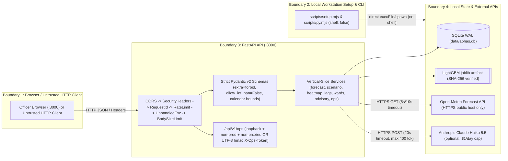

# Threat Model — Abhas (আভাস): Ward-Level Dengue Early Warning

_Owner: PLATFORM-SEC (Role 13 · Security & Red-Team Engineer) · Updated: 2026-11-21_
_Traceability: `docs/PRD.md` (AC-4, AC-9, AC-10, AC-17, NFR-7, NFR-8) · `docs/system-design.md` · `.orca-team/reviews/r1-security-lead.md` (SEC-1…SEC-12)_

This threat model covers the Abhas local public-health decision-support console (Next.js 16 frontend, FastAPI + LightGBM API, SQLite WAL database, optional Open-Meteo live weather client, optional Claude Haiku 5.5 advisory client, and setup/packaging scripts).

---

## 1. Assets

1. **Operator credentials and spend budget**: Optional `ANTHROPIC_API_KEY` (capped at `$1.00/day` in `llm_traces`), optional `OPS_TOKEN`, and future Stage-2 `DATABASE_URL` credentials.
2. **Local workstation integrity**: The health officer's or judge's laptop running `npm run setup` (`scripts/setup.mjs`), `npm run dev` (`scripts/py.mjs`), and loading the serialized LightGBM `.joblib` model artifact.
3. **Forecast accuracy and service availability**: Single-process uvicorn worker, LightGBM multi-horizon boosters, SQLite WAL database (`data/abhas.db` with 60 wards and 31,320 historical observations), and L1/L2 prediction caches.
4. **Operational telemetry**: `GET /api/v1/ops` (model version, request volume, cache hit rate, inference latency, external API call volume, and daily LLM spend).
5. **Advisory integrity**: Grounded English and Bangla ward briefings whose numeric figures must never contradict or invent values outside the model forecast.

## 2. Actors

1. **City health officer / epidemiologist (benign user)**: Operates the browser dashboard on `http://localhost:3000` (dataset mode by default; optional live Open-Meteo or LLM advisory mode).
2. **Untrusted HTTP client / cross-origin webpage**: A hostile webpage open in the officer's browser attempting cross-origin requests to `localhost:8000`, or a remote LAN/network client if the API is exposed via `--host 0.0.0.0`, Docker, or a Stage-2 reverse proxy.
3. **Malicious CSV consumer / indirect data attacker**: An attacker supplying crafted strings or payloads targeting CSV exports (spreadsheet formula injection), HTTP headers (`X-Request-ID`, `X-Ops-Token`, `X-Forwarded-For`), or JSON fields (`NaN`, `Infinity`, oversized chunked streams, unknown extra keys).
4. **Compromised dependency or tampered artifact**: Tampered `.joblib` pickle file (`CWE-502`), malicious npm install script, or unverified package installation.
5. **Faulty or adversarial upstream provider**: Open-Meteo timeout/5xx/malformed payload or Anthropic LLM returning malformed JSON, prompt-injected output, or hallucinated case counts.

## 3. Trust Boundaries

## 4. STRIDE Per Boundary

| Threat | Boundary | Attack Vector | Control in Abhas |
|---|---|---|---|
| **Spoofing** | B1 → B3 | Remote or proxied caller accessing `/api/v1/ops` with unset `OPS_TOKEN`; `X-Forwarded-For` IP spoofing to bypass rate limits; control-char `X-Request-ID` spoofing. | `/api/v1/ops` requires `X-Ops-Token` unless non-production direct loopback without `X-Forwarded-For` (SEC-2); `RateLimitMiddleware` ignores `X-Forwarded-For` unless peer is in explicit `TRUSTED_PROXIES` and selects rightmost untrusted IP (SEC-8); `X-Request-ID` restricted to `^[A-Za-z0-9._-]{1,64}$` (SEC-4). |
| **Tampering** | B2 → B4, B1 → B3 | Shell metacharacter injection via clone path in `setup.mjs`; npm postinstall script execution; tampered `.joblib` pickle artifact; unexpected JSON fields; CSV formula injection. | Zero `shell: true` in `scripts/setup.mjs` and `scripts/py.mjs` (SEC-1); `npm ci --ignore-scripts` (SEC-9); mandatory SHA-256 verification against `metadata.json` before `joblib.load()` (CWE-502); `ConfigDict(extra="forbid", allow_inf_nan=False)` on all request/query models (SEC-12); CSV cell neutralization helper prefixing `=`, `+`, `-`, `@`, `\t`, `\r` with `'`. |
| **Repudiation** | B3 | Missing correlation IDs on access and 500 error logs. | Pure ASGI `RequestIdMiddleware` emits access logs and `UnhandledExceptionMiddleware` logs errors strictly inside the active `request_id_var` context before resetting it (SEC-4, SEC-7). |
| **Information Disclosure** | B3 → B1, B3 → Logs | Secrets/tokens/DSNs printed in JSON logs or tracebacks; Swagger/OpenAPI exposed in production; cached telemetry; stack traces in 500/422 bodies. | `JsonFormatter` redacts Anthropic/OpenAI/Google/GitHub/Slack/AWS keys, `Bearer`, `Authorization`, `X-Ops-Token`, `password=`, and Postgres DSNs in `msg` and `exc` (SEC-4); `SecretStr` for keys; `/docs`, `/redoc`, `/openapi.json` disabled when `APP_ENV=production` (SEC-11); `Cache-Control: no-store` on `/api/v1/ops`, `/healthz`, `/readyz` (SEC-11); validation errors strip Pydantic `input`/`ctx` and 500s return generic `application/problem+json` (SEC-7). |
| **Denial of Service** | B1 → B3 | Multi-MB chunked POSTs exhausting worker RAM; `origin_week=9999-12-27` causing 500 `OverflowError`; non-ASCII `X-Ops-Token` causing 500 `TypeError`; burst flooding; FIFO bucket eviction resetting active abusers; `startswith` rate-limit bypass (`/docs_fake`). | Pure ASGI streaming `BodySizeLimitMiddleware` aborts immediately once cumulative bytes exceed 64 KB (SEC-3); calendar bounds `[2016-01-04, 2100-12-31]` in `IsoWeek` + dataset range `[2016-02-29, 2025-12-29]` (SEC-5); UTF-8 byte comparison in `hmac.compare_digest` (SEC-6); exact `EXEMPT` set + LRU bucket eviction in `RateLimitMiddleware` (SEC-8). |
| **Elevation of Privilege** | B2, B3 | `cmd.exe` command execution during Windows setup; `APP_ENV=prod` bypassing production guards; config-level SSRF via `OPEN_METEO_BASE_URL` or wildcard `CORS_ORIGINS=*`. | `shell: false` everywhere in setup (SEC-1); `APP_ENV=prod` normalized to `"production"` (CR-10); `Settings` rejects wildcard/`null` CORS origins, requires `https://` and non-private/non-metadata host for `OPEN_METEO_BASE_URL` outside `APP_ENV=test`, and enforces `gt=0` finite timeouts/budgets (SEC-10). |

## 5. OWASP Top 10 for LLM Applications 2026

| ID | Risk | Applies? | Control in this app | Attack ids |
|---|---|---|---|---|
| LLM01 | Prompt Injection | Yes (narrow surface) | `AdvisoryRequest` accepts zero free-text prompts — only strict identifiers (`WardId` regex `^[A-Za-z0-9_-]{1,32}$`, `DatasetOriginWeek`, `Horizon` 1..4, `Literal["en","bn"]`). The versioned prompt (`prompts/advisory_v1.md`) wraps forecast JSON in `<forecast_data>...</forecast_data>` and instructs the model to treat all fields (including ward names) as untrusted data, never instructions. | RT-17, RT-18, RT-19 |
| LLM02 | Sensitive Information Disclosure | Yes | `ANTHROPIC_API_KEY` and `OPS_TOKEN` use `SecretStr`; never placed in prompts or API responses; `JsonFormatter` redacts secrets/tokens/DSNs in both log messages and exception tracebacks; 500/422 responses never echo inputs, tracebacks, or SQL. | RT-25, RT-26, RT-27 |
| LLM03 | Excessive Agency | No (N/A) | `app/ports/llm.py` exposes single-shot `complete_json` only. Zero tool calling, zero function execution, zero write/side-effect permissions, and no autonomous agent loop exist in Abhas. | — |
| LLM04 | Supply Chain | Yes | Pinned lockfiles (`apps/api/uv.lock`, `package-lock.json`, `apps/web/package-lock.json`); `npm ci --ignore-scripts`; `pip-audit` and `npm audit --omit=dev` clean (0 CVEs); `scripts/setup.mjs` runs `shell: false` and verifies model SHA-256 (`ml.verify_artifact`). | RT-28 |
| LLM05 | Data and Model Poisoning | Partial | Historical dataset (`data/raw/`) is read-only and verified by SHA-256 at seed; zero user-facing upload or training endpoints exist; LightGBM `.joblib` artifact (`CWE-502` pickle surface) is verified against `metadata.json` SHA-256 via constant-time `hmac.compare_digest` before `joblib.load()`. | RT-28 |
| LLM06 | Unbounded Consumption | Yes | Streaming 64 KB ASGI body-size cap (`413`); per-IP sliding-window rate limit (`120/min`, stricter `20/min` on `/api/v1/advisory` when LLM enabled, `429` + `Retry-After`, exact exempt set, LRU eviction); LLM `max_tokens <= 400`, `20 s` timeout, `$1.00/day` budget persisted in `llm_traces` with automatic template fallback; `ward_ids <= 60`, `horizons <= 4`. | RT-01, RT-02, RT-09, RT-10, RT-20 |
| LLM07 | Misinformation | Yes | Advisory output is validated against a strict Pydantic schema AND a deterministic numeric-grounding validator (`validate_advisory_numbers`) supporting both ASCII (`0-9`) and Bangla (`০-৯`) digits; any invented number triggers at most 1 repair retry then falls back to the deterministic template (`numbers_validated: true`). Model card discloses simulated dataset limits. | RT-19, RT-29 |
| LLM08 | Hidden Context Exposure | Low | No system prompt or internal instructions are exposed in `AdvisoryResponse`; structured JSON output schema caps fields (`headline <= 160`, `summary <= 800`, `actions <= 5`); prompt instructions explicitly forbid following data-embedded directives to reveal instructions. | RT-18 |
| LLM09 | Vector and Embedding Weaknesses | No (N/A) | Abhas does not use RAG, embeddings, or a vector database (ADR-0006); all features come from structured relational weekly weather and case tables. | — |
| LLM10 | Improper Output Handling | Partial | API returns strict JSON (`application/json` / `application/problem+json`) with `X-Content-Type-Options: nosniff`, `X-Frame-Options: DENY`, and `Referrer-Policy: no-referrer`; Next.js renders text via React escaping (no `dangerouslySetInnerHTML`); CSV exports neutralize spreadsheet formula prefixes (`=`, `+`, `-`, `@`). | RT-16, RT-26, RT-29 |

## 6. OWASP Top 10:2025 (Web & API Surface)

| ID | Category | Posture & Remediations | Attack ids |
|---|---|---|---|
| A01:2025 | Broken Access Control | `/api/v1/ops` fails closed (`401`) for remote peers, proxied requests (`X-Forwarded-For`), and `APP_ENV=production` when `OPS_TOKEN` is unset (SEC-2); CORS enforces explicit origin allow-list with `allow_credentials=False` (SEC-10). | RT-22, RT-23, RT-24 |
| A02:2025 | Security Misconfiguration | `APP_ENV=prod` normalizes to `"production"` (CR-10); `/docs`, `/redoc`, `/openapi.json` disabled in production; API security headers + `Cache-Control: no-store` on ops/health endpoints (SEC-11); `Settings` validates CORS origins, SSRF-safe Open-Meteo HTTPS URL, and positive finite timeouts/budgets (SEC-10). | RT-24, RT-26, RT-30 |
| A03:2025 | Software Supply Chain Failures | Lockfiles committed; `npm ci --ignore-scripts` in root and web setup (SEC-9); 0 CVEs in `pip-audit` and `npm audit --omit=dev`; Linux OpenMP Dockerfiles run non-root. | RT-28 |
| A04:2025 | Cryptographic Failures | `X-Ops-Token` and artifact SHA-256 use constant-time `hmac.compare_digest` over UTF-8 bytes (SEC-6); secrets wrapped in Pydantic `SecretStr`. | RT-22, RT-23 |
| A05:2025 | Injection | Zero `shell: true` in setup/CLI scripts (SEC-1); SQLAlchemy parameterized queries only; `WardId` strict regex blocks SQLi, path traversal, and CRLF; `X-Request-ID` sanitized against ANSI/CRLF header/log injection (SEC-4); CSV formula sanitizer (`sanitize_csv_cell`). | RT-06, RT-07, RT-08, RT-16, RT-21 |
| A06:2025 | Insecure Design | Streaming ASGI 64 KB body limit (SEC-3); `TRUSTED_PROXIES` right-to-left XFF parsing, exact exempt paths, and LRU rate-limit eviction (SEC-8); `FAULT_INJECT` disabled outside `APP_ENV=test`. | RT-01, RT-02, RT-20 |
| A07:2025 | Authentication Failures | Empty or whitespace-only `OPS_TOKEN` fails closed outside direct dev/test loopback; brute-force attempts subject to rate limiting and constant-time comparison (SEC-2, SEC-6). | RT-22, RT-23 |
| A08:2025 | Software or Data Integrity Failures | Mandatory SHA-256 verification before `joblib.load()`; `extra="forbid"` and `allow_inf_nan=False` reject tampered/extra fields and `NaN`/`±Infinity` (SEC-12). | RT-03, RT-04, RT-05, RT-11, RT-12 |
| A09:2025 | Security Logging & Alerting Failures | Secret redaction on `JsonFormatter` (`msg` and `exc`); `request_id` retained in access logs and 500 error logs; sanitized `X-Request-ID` (SEC-4, SEC-7). | RT-21, RT-27 |
| A10:2025 | Mishandling of Exceptional Conditions | Calendar window `[2016-01-04, 2100-12-31]` prevents `9999-12-27` `OverflowError` (SEC-5); UTF-8 byte `compare_digest` prevents non-ASCII `TypeError` (SEC-6); `StarletteHTTPException` returns `problem+json` for 404/405; `UnhandledExceptionMiddleware` inside CORS/RequestId preserves headers and generic 500 `problem+json` (SEC-7). | RT-13, RT-14, RT-15, RT-23, RT-25 |

## 7. Residual Risks & Stage-2 Hardening Path

- **Local single-office scope (ADR-0008)**: Stage 1 has no user accounts or multi-tenant RBAC by design. Before hosting publicly on the internet (Stage 2), put Abhas behind institutional SSO/OIDC authentication, TLS termination, and Postgres with network-isolated credentials.
- **In-process rate limiting**: `RateLimitMiddleware` runs in-process for a single uvicorn worker; Stage 2 multi-worker deployments should move sliding-window state to Redis or an edge WAF while keeping `TRUSTED_PROXIES` configured explicitly.
- **Pickle deserialization (`joblib`)**: Mitigated in Stage 1 by strict SHA-256 verification against committed `metadata.json` before `joblib.load()`; Stage 2 can additionally migrate LightGBM boosters to native text/JSON `Booster(model_file=...)` plus JSON calibration sidecars to eliminate pickle entirely.
- **Secrets scanning (`gitleaks`)**: Tracked files and commit history are verified clean via git regex scans; CI and developer workstations with `gitleaks` installed run full history scans via `gates.mjs redteam`.
